# 项目宠物 Emoji 图鉴 · Pet Emoji Atlas

**51 个项目 × 12 种形态 = 612 枚宠物表情 emoji。**
每一枚同时提供 **图片（SVG / PNG）+ 彩色字体（CBDT/CBLC TTF）+ 短码（shortcode）**。

> **授权 / License**：本项目中的项目宠物、图片、图标、表情及字体中的图形字形均为
> **非开源资产**，商业使用需取得商业授权。详见 [ASSETS-LICENSE.md](ASSETS-LICENSE.md)。

## 12 种形态

笑 / 欢乐 / 哭 / 沮丧 / 惊恐 / 愤怒 / 撒娇 / 卖萌 / 讨好 / 敲打 / 捂脸 / 吐舌头

## 用法

### 1. 图片

```markdown


```

### 2. 字体

引入 `font/emoji.css` 后，使用字体族 `Pet Emoji Atlas` 与码位 `U+E000` 显示对应字形；支持 `liga` 连字的编辑器也可直接输入短码。

```css
@import url("font/emoji.css");
```

字体为 CBDT/CBLC 彩色位图字体；支持彩色位图字体的环境会显示对应宠物表情，否则请使用图片。

### 3. 短码

```text
:ads-php-smile:
:emoji-ads-php-smile:
```

- 主短码：`:<项目>-<形态>:`
- 别名：`:emoji-<项目>-<形态>:`
- 字体码位：`U+E000..U+E263`
- 全量映射见 [shortcodes.json](shortcodes.json)；字体内置主短码 `:<项目>-<形态>:` 的 `liga` 连字。
- `:emoji-<项目>-<形态>:` 别名可用 `shortcodes.json` 映射为图片或对应码位；需要把短码渲染成图片时，查 `image` 字段。

## 项目总览

| # | 宠物 | 项目 | 短码前缀 | 形态 |
|---|---|---|---|---|
| 1 | 阿章 | `ads-php` | `:ads-php-*:` | 12 |
| 2 | 小约 | `appointment-php` | `:appointment-php-*:` | 12 |
| 3 | Rusty | `bee-rust` | `:bee-rust-*:` | 12 |
| 4 | 阿守 | `bee-rust-admin` | `:bee-rust-admin-*:` | 12 |
| 5 | 云团 | `cloud-php` | `:cloud-php-*:` | 12 |
| 6 | E-Cat | `e-cat` | `:e-cat-*:` | 12 |
| 7 | Lumi | `erik-talk` | `:erik-talk-*:` | 12 |
| 8 | 小八爪 | `erp-php` | `:erp-php-*:` | 12 |
| 9 | Dicey | `game-platform-php` | `:game-platform-php-*:` | 12 |
| 10 | 霜霜 | `insurance-service` | `:insurance-service-*:` | 12 |
| 11 | E-Cat | `integrated-global-logistics` | `:integrated-global-logistics-*:` | 12 |
| 12 | IoT Bot | `iot-platform` | `:iot-platform-*:` | 12 |
| 13 | 租租鼠 | `item-rental` | `:item-rental-*:` | 12 |
| 14 | 小音机 | `omb` | `:omb-*:` | 12 |
| 15 | 小安 | `open-admin` | `:open-admin-*:` | 12 |
| 16 | Novi | `open-novel` | `:open-novel-*:` | 12 |
| 17 | 南南 | `open-travel` | `:open-travel-*:` | 12 |
| 18 | 小筑 | `property-management-platform` | `:property-management-platform-*:` | 12 |
| 19 | 犇犇 | `quantitative-trading` | `:quantitative-trading-*:` | 12 |
| 20 | 雪球 Snowy | `shop-php` | `:shop-php-*:` | 12 |
| 21 | Bub | `social` | `:social-*:` | 12 |
| 22 | ssd | `ssd` | `:ssd-*:` | 12 |
| 23 | 超猫 SuperCat | `super-ops` | `:super-ops-*:` | 12 |
| 24 | 小运 | `bag/canal` | `:canal-*:` | 12 |
| 25 | 小德 | `bag/druid-rust` | `:druid-rust-*:` | 12 |
| 26 | Locky | `bag/encryption-rust` | `:encryption-rust-*:` | 12 |
| 27 | 小侦 Scouty | `bag/go-scout` | `:go-scout-*:` | 12 |
| 28 | Kee · 橘猫 | `bag/jwt-rust` | `:jwt-rust-*:` | 12 |
| 29 | Posty | `bag/poster-rust` | `:poster-rust-*:` | 12 |
| 30 | Scout | `bag/rust-scout` | `:rust-scout-*:` | 12 |
| 31 | 哨兵鼠 | `bag/security-go` | `:security-go-*:` | 12 |
| 32 | 甲哨 Sentri | `bag/security-rust` | `:security-rust-*:` | 12 |
| 33 | 以太兽 | `erikwang2013/aetherupload-webman` | `:aetherupload-webman-*:` | 12 |
| 34 | Apidoc | `erikwang2013/apidoc-php` | `:apidoc-php-*:` | 12 |
| 35 | ClickHouse 仓鼠 | `erikwang2013/clickhouse-php` | `:clickhouse-php-*:` | 12 |
| 36 | Consu | `erikwang2013/consul-php` | `:consul-php-*:` | 12 |
| 37 | Locky | `erikwang2013/encryptable` | `:encryptable-*:` | 12 |
| 38 | Locky | `erikwang2013/encryption` | `:encryption-*:` | 12 |
| 39 | Etchy | `erikwang2013/etcd` | `:etcd-*:` | 12 |
| 40 | 哈希迪 Hashy | `erikwang2013/hashids` | `:hashids-*:` | 12 |
| 41 | Kee · 柴犬门卫 | `erikwang2013/jwt-webman` | `:jwt-webman-*:` | 12 |
| 42 | Posty | `erikwang2013/poster-php` | `:poster-php-*:` | 12 |
| 43 | Seasony 季灵 | `erikwang2013/season` | `:season-*:` | 12 |
| 44 | 小盾 | `erikwang2013/security-php` | `:security-php-*:` | 12 |
| 45 | 雪花精灵 | `erikwang2013/snowflake-php` | `:snowflake-php-*:` | 12 |
| 46 | Sniffy | `erikwang2013/webman-scout` | `:webman-scout-*:` | 12 |
| 47 | Xhpy | `erikwang2013/xhprof` | `:xhprof-*:` | 12 |
| 48 | 焰焰 | `erikwang2013/xhprof-webman` | `:xhprof-webman-*:` | 12 |
| 49 | 吞吞 | `oss` | `:oss-*:` | 12 |
| 50 | Pax | `polypack` | `:polypack-*:` | 12 |
| 51 | 小欧 | `opi` | `:opi-*:` | 12 |

## 逐项目预览

### 阿章 · `ads-php` · `:ads-php-*:`

 `:ads-php-smile:` ·  `:ads-php-joy:` ·  `:ads-php-cry:` ·  `:ads-php-depressed:` ·  `:ads-php-terrified:` ·  `:ads-php-angry:`

 `:ads-php-coquettish:` ·  `:ads-php-cute:` ·  `:ads-php-pleasing:` ·  `:ads-php-knocking:` ·  `:ads-php-facepalm:` ·  `:ads-php-tongue:`

### 小约 · `appointment-php` · `:appointment-php-*:`

 `:appointment-php-smile:` ·  `:appointment-php-joy:` ·  `:appointment-php-cry:` ·  `:appointment-php-depressed:` ·  `:appointment-php-terrified:` ·  `:appointment-php-angry:`

 `:appointment-php-coquettish:` ·  `:appointment-php-cute:` ·  `:appointment-php-pleasing:` ·  `:appointment-php-knocking:` ·  `:appointment-php-facepalm:` ·  `:appointment-php-tongue:`

### Rusty · `bee-rust` · `:bee-rust-*:`

 `:bee-rust-smile:` ·  `:bee-rust-joy:` ·  `:bee-rust-cry:` ·  `:bee-rust-depressed:` ·  `:bee-rust-terrified:` ·  `:bee-rust-angry:`

 `:bee-rust-coquettish:` ·  `:bee-rust-cute:` ·  `:bee-rust-pleasing:` ·  `:bee-rust-knocking:` ·  `:bee-rust-facepalm:` ·  `:bee-rust-tongue:`

### 阿守 · `bee-rust-admin` · `:bee-rust-admin-*:`

 `:bee-rust-admin-smile:` ·  `:bee-rust-admin-joy:` ·  `:bee-rust-admin-cry:` ·  `:bee-rust-admin-depressed:` ·  `:bee-rust-admin-terrified:` ·  `:bee-rust-admin-angry:`

 `:bee-rust-admin-coquettish:` ·  `:bee-rust-admin-cute:` ·  `:bee-rust-admin-pleasing:` ·  `:bee-rust-admin-knocking:` ·  `:bee-rust-admin-facepalm:` ·  `:bee-rust-admin-tongue:`

### 云团 · `cloud-php` · `:cloud-php-*:`

 `:cloud-php-smile:` ·  `:cloud-php-joy:` ·  `:cloud-php-cry:` ·  `:cloud-php-depressed:` ·  `:cloud-php-terrified:` ·  `:cloud-php-angry:`

 `:cloud-php-coquettish:` ·  `:cloud-php-cute:` ·  `:cloud-php-pleasing:` ·  `:cloud-php-knocking:` ·  `:cloud-php-facepalm:` ·  `:cloud-php-tongue:`

### E-Cat · `e-cat` · `:e-cat-*:`

 `:e-cat-smile:` ·  `:e-cat-joy:` ·  `:e-cat-cry:` ·  `:e-cat-depressed:` ·  `:e-cat-terrified:` ·  `:e-cat-angry:`

 `:e-cat-coquettish:` ·  `:e-cat-cute:` ·  `:e-cat-pleasing:` ·  `:e-cat-knocking:` ·  `:e-cat-facepalm:` ·  `:e-cat-tongue:`

### Lumi · `erik-talk` · `:erik-talk-*:`

 `:erik-talk-smile:` ·  `:erik-talk-joy:` ·  `:erik-talk-cry:` ·  `:erik-talk-depressed:` ·  `:erik-talk-terrified:` ·  `:erik-talk-angry:`

 `:erik-talk-coquettish:` ·  `:erik-talk-cute:` ·  `:erik-talk-pleasing:` ·  `:erik-talk-knocking:` ·  `:erik-talk-facepalm:` ·  `:erik-talk-tongue:`

### 小八爪 · `erp-php` · `:erp-php-*:`

 `:erp-php-smile:` ·  `:erp-php-joy:` ·  `:erp-php-cry:` ·  `:erp-php-depressed:` ·  `:erp-php-terrified:` ·  `:erp-php-angry:`

 `:erp-php-coquettish:` ·  `:erp-php-cute:` ·  `:erp-php-pleasing:` ·  `:erp-php-knocking:` ·  `:erp-php-facepalm:` ·  `:erp-php-tongue:`

### Dicey · `game-platform-php` · `:game-platform-php-*:`

 `:game-platform-php-smile:` ·  `:game-platform-php-joy:` ·  `:game-platform-php-cry:` ·  `:game-platform-php-depressed:` ·  `:game-platform-php-terrified:` ·  `:game-platform-php-angry:`

 `:game-platform-php-coquettish:` ·  `:game-platform-php-cute:` ·  `:game-platform-php-pleasing:` ·  `:game-platform-php-knocking:` ·  `:game-platform-php-facepalm:` ·  `:game-platform-php-tongue:`

### 霜霜 · `insurance-service` · `:insurance-service-*:`

 `:insurance-service-smile:` ·  `:insurance-service-joy:` ·  `:insurance-service-cry:` ·  `:insurance-service-depressed:` ·  `:insurance-service-terrified:` ·  `:insurance-service-angry:`

 `:insurance-service-coquettish:` ·  `:insurance-service-cute:` ·  `:insurance-service-pleasing:` ·  `:insurance-service-knocking:` ·  `:insurance-service-facepalm:` ·  `:insurance-service-tongue:`

### E-Cat · `integrated-global-logistics` · `:integrated-global-logistics-*:`

 `:integrated-global-logistics-smile:` ·  `:integrated-global-logistics-joy:` ·  `:integrated-global-logistics-cry:` ·  `:integrated-global-logistics-depressed:` ·  `:integrated-global-logistics-terrified:` ·  `:integrated-global-logistics-angry:`

 `:integrated-global-logistics-coquettish:` ·  `:integrated-global-logistics-cute:` ·  `:integrated-global-logistics-pleasing:` ·  `:integrated-global-logistics-knocking:` ·  `:integrated-global-logistics-facepalm:` ·  `:integrated-global-logistics-tongue:`

### IoT Bot · `iot-platform` · `:iot-platform-*:`

 `:iot-platform-smile:` ·  `:iot-platform-joy:` ·  `:iot-platform-cry:` ·  `:iot-platform-depressed:` ·  `:iot-platform-terrified:` ·  `:iot-platform-angry:`

 `:iot-platform-coquettish:` ·  `:iot-platform-cute:` ·  `:iot-platform-pleasing:` ·  `:iot-platform-knocking:` ·  `:iot-platform-facepalm:` ·  `:iot-platform-tongue:`

### 租租鼠 · `item-rental` · `:item-rental-*:`

 `:item-rental-smile:` ·  `:item-rental-joy:` ·  `:item-rental-cry:` ·  `:item-rental-depressed:` ·  `:item-rental-terrified:` ·  `:item-rental-angry:`

 `:item-rental-coquettish:` ·  `:item-rental-cute:` ·  `:item-rental-pleasing:` ·  `:item-rental-knocking:` ·  `:item-rental-facepalm:` ·  `:item-rental-tongue:`

### 小音机 · `omb` · `:omb-*:`

 `:omb-smile:` ·  `:omb-joy:` ·  `:omb-cry:` ·  `:omb-depressed:` ·  `:omb-terrified:` ·  `:omb-angry:`

 `:omb-coquettish:` ·  `:omb-cute:` ·  `:omb-pleasing:` ·  `:omb-knocking:` ·  `:omb-facepalm:` ·  `:omb-tongue:`

### 小安 · `open-admin` · `:open-admin-*:`

 `:open-admin-smile:` ·  `:open-admin-joy:` ·  `:open-admin-cry:` ·  `:open-admin-depressed:` ·  `:open-admin-terrified:` ·  `:open-admin-angry:`

 `:open-admin-coquettish:` ·  `:open-admin-cute:` ·  `:open-admin-pleasing:` ·  `:open-admin-knocking:` ·  `:open-admin-facepalm:` ·  `:open-admin-tongue:`

### Novi · `open-novel` · `:open-novel-*:`

 `:open-novel-smile:` ·  `:open-novel-joy:` ·  `:open-novel-cry:` ·  `:open-novel-depressed:` ·  `:open-novel-terrified:` ·  `:open-novel-angry:`

 `:open-novel-coquettish:` ·  `:open-novel-cute:` ·  `:open-novel-pleasing:` ·  `:open-novel-knocking:` ·  `:open-novel-facepalm:` ·  `:open-novel-tongue:`

### 南南 · `open-travel` · `:open-travel-*:`

 `:open-travel-smile:` ·  `:open-travel-joy:` ·  `:open-travel-cry:` ·  `:open-travel-depressed:` ·  `:open-travel-terrified:` ·  `:open-travel-angry:`

 `:open-travel-coquettish:` ·  `:open-travel-cute:` ·  `:open-travel-pleasing:` ·  `:open-travel-knocking:` ·  `:open-travel-facepalm:` ·  `:open-travel-tongue:`

### 小筑 · `property-management-platform` · `:property-management-platform-*:`

 `:property-management-platform-smile:` ·  `:property-management-platform-joy:` ·  `:property-management-platform-cry:` ·  `:property-management-platform-depressed:` ·  `:property-management-platform-terrified:` ·  `:property-management-platform-angry:`

 `:property-management-platform-coquettish:` ·  `:property-management-platform-cute:` ·  `:property-management-platform-pleasing:` ·  `:property-management-platform-knocking:` ·  `:property-management-platform-facepalm:` ·  `:property-management-platform-tongue:`

### 犇犇 · `quantitative-trading` · `:quantitative-trading-*:`

 `:quantitative-trading-smile:` ·  `:quantitative-trading-joy:` ·  `:quantitative-trading-cry:` ·  `:quantitative-trading-depressed:` ·  `:quantitative-trading-terrified:` ·  `:quantitative-trading-angry:`

 `:quantitative-trading-coquettish:` ·  `:quantitative-trading-cute:` ·  `:quantitative-trading-pleasing:` ·  `:quantitative-trading-knocking:` ·  `:quantitative-trading-facepalm:` ·  `:quantitative-trading-tongue:`

### 雪球 Snowy · `shop-php` · `:shop-php-*:`

 `:shop-php-smile:` ·  `:shop-php-joy:` ·  `:shop-php-cry:` ·  `:shop-php-depressed:` ·  `:shop-php-terrified:` ·  `:shop-php-angry:`

 `:shop-php-coquettish:` ·  `:shop-php-cute:` ·  `:shop-php-pleasing:` ·  `:shop-php-knocking:` ·  `:shop-php-facepalm:` ·  `:shop-php-tongue:`

### Bub · `social` · `:social-*:`

 `:social-smile:` ·  `:social-joy:` ·  `:social-cry:` ·  `:social-depressed:` ·  `:social-terrified:` ·  `:social-angry:`

 `:social-coquettish:` ·  `:social-cute:` ·  `:social-pleasing:` ·  `:social-knocking:` ·  `:social-facepalm:` ·  `:social-tongue:`

### ssd · `ssd` · `:ssd-*:`

 `:ssd-smile:` ·  `:ssd-joy:` ·  `:ssd-cry:` ·  `:ssd-depressed:` ·  `:ssd-terrified:` ·  `:ssd-angry:`

 `:ssd-coquettish:` ·  `:ssd-cute:` ·  `:ssd-pleasing:` ·  `:ssd-knocking:` ·  `:ssd-facepalm:` ·  `:ssd-tongue:`

### 超猫 SuperCat · `super-ops` · `:super-ops-*:`

 `:super-ops-smile:` ·  `:super-ops-joy:` ·  `:super-ops-cry:` ·  `:super-ops-depressed:` ·  `:super-ops-terrified:` ·  `:super-ops-angry:`

 `:super-ops-coquettish:` ·  `:super-ops-cute:` ·  `:super-ops-pleasing:` ·  `:super-ops-knocking:` ·  `:super-ops-facepalm:` ·  `:super-ops-tongue:`

### 小运 · `bag/canal` · `:canal-*:`

 `:canal-smile:` ·  `:canal-joy:` ·  `:canal-cry:` ·  `:canal-depressed:` ·  `:canal-terrified:` ·  `:canal-angry:`

 `:canal-coquettish:` ·  `:canal-cute:` ·  `:canal-pleasing:` ·  `:canal-knocking:` ·  `:canal-facepalm:` ·  `:canal-tongue:`

### 小德 · `bag/druid-rust` · `:druid-rust-*:`

 `:druid-rust-smile:` ·  `:druid-rust-joy:` ·  `:druid-rust-cry:` ·  `:druid-rust-depressed:` ·  `:druid-rust-terrified:` ·  `:druid-rust-angry:`

 `:druid-rust-coquettish:` ·  `:druid-rust-cute:` ·  `:druid-rust-pleasing:` ·  `:druid-rust-knocking:` ·  `:druid-rust-facepalm:` ·  `:druid-rust-tongue:`

### Locky · `bag/encryption-rust` · `:encryption-rust-*:`

 `:encryption-rust-smile:` ·  `:encryption-rust-joy:` ·  `:encryption-rust-cry:` ·  `:encryption-rust-depressed:` ·  `:encryption-rust-terrified:` ·  `:encryption-rust-angry:`

 `:encryption-rust-coquettish:` ·  `:encryption-rust-cute:` ·  `:encryption-rust-pleasing:` ·  `:encryption-rust-knocking:` ·  `:encryption-rust-facepalm:` ·  `:encryption-rust-tongue:`

### 小侦 Scouty · `bag/go-scout` · `:go-scout-*:`

 `:go-scout-smile:` ·  `:go-scout-joy:` ·  `:go-scout-cry:` ·  `:go-scout-depressed:` ·  `:go-scout-terrified:` ·  `:go-scout-angry:`

 `:go-scout-coquettish:` ·  `:go-scout-cute:` ·  `:go-scout-pleasing:` ·  `:go-scout-knocking:` ·  `:go-scout-facepalm:` ·  `:go-scout-tongue:`

### Kee · 橘猫 · `bag/jwt-rust` · `:jwt-rust-*:`

 `:jwt-rust-smile:` ·  `:jwt-rust-joy:` ·  `:jwt-rust-cry:` ·  `:jwt-rust-depressed:` ·  `:jwt-rust-terrified:` ·  `:jwt-rust-angry:`

 `:jwt-rust-coquettish:` ·  `:jwt-rust-cute:` ·  `:jwt-rust-pleasing:` ·  `:jwt-rust-knocking:` ·  `:jwt-rust-facepalm:` ·  `:jwt-rust-tongue:`

### Posty · `bag/poster-rust` · `:poster-rust-*:`

 `:poster-rust-smile:` ·  `:poster-rust-joy:` ·  `:poster-rust-cry:` ·  `:poster-rust-depressed:` ·  `:poster-rust-terrified:` ·  `:poster-rust-angry:`

 `:poster-rust-coquettish:` ·  `:poster-rust-cute:` ·  `:poster-rust-pleasing:` ·  `:poster-rust-knocking:` ·  `:poster-rust-facepalm:` ·  `:poster-rust-tongue:`

### Scout · `bag/rust-scout` · `:rust-scout-*:`

 `:rust-scout-smile:` ·  `:rust-scout-joy:` ·  `:rust-scout-cry:` ·  `:rust-scout-depressed:` ·  `:rust-scout-terrified:` ·  `:rust-scout-angry:`

 `:rust-scout-coquettish:` ·  `:rust-scout-cute:` ·  `:rust-scout-pleasing:` ·  `:rust-scout-knocking:` ·  `:rust-scout-facepalm:` ·  `:rust-scout-tongue:`

### 哨兵鼠 · `bag/security-go` · `:security-go-*:`

 `:security-go-smile:` ·  `:security-go-joy:` ·  `:security-go-cry:` ·  `:security-go-depressed:` ·  `:security-go-terrified:` ·  `:security-go-angry:`

 `:security-go-coquettish:` ·  `:security-go-cute:` ·  `:security-go-pleasing:` ·  `:security-go-knocking:` ·  `:security-go-facepalm:` ·  `:security-go-tongue:`

### 甲哨 Sentri · `bag/security-rust` · `:security-rust-*:`

 `:security-rust-smile:` ·  `:security-rust-joy:` ·  `:security-rust-cry:` ·  `:security-rust-depressed:` ·  `:security-rust-terrified:` ·  `:security-rust-angry:`

 `:security-rust-coquettish:` ·  `:security-rust-cute:` ·  `:security-rust-pleasing:` ·  `:security-rust-knocking:` ·  `:security-rust-facepalm:` ·  `:security-rust-tongue:`

### 以太兽 · `erikwang2013/aetherupload-webman` · `:aetherupload-webman-*:`

 `:aetherupload-webman-smile:` ·  `:aetherupload-webman-joy:` ·  `:aetherupload-webman-cry:` ·  `:aetherupload-webman-depressed:` ·  `:aetherupload-webman-terrified:` ·  `:aetherupload-webman-angry:`

 `:aetherupload-webman-coquettish:` ·  `:aetherupload-webman-cute:` ·  `:aetherupload-webman-pleasing:` ·  `:aetherupload-webman-knocking:` ·  `:aetherupload-webman-facepalm:` ·  `:aetherupload-webman-tongue:`

### Apidoc · `erikwang2013/apidoc-php` · `:apidoc-php-*:`

 `:apidoc-php-smile:` ·  `:apidoc-php-joy:` ·  `:apidoc-php-cry:` ·  `:apidoc-php-depressed:` ·  `:apidoc-php-terrified:` ·  `:apidoc-php-angry:`

 `:apidoc-php-coquettish:` ·  `:apidoc-php-cute:` ·  `:apidoc-php-pleasing:` ·  `:apidoc-php-knocking:` ·  `:apidoc-php-facepalm:` ·  `:apidoc-php-tongue:`

### ClickHouse 仓鼠 · `erikwang2013/clickhouse-php` · `:clickhouse-php-*:`

 `:clickhouse-php-smile:` ·  `:clickhouse-php-joy:` ·  `:clickhouse-php-cry:` ·  `:clickhouse-php-depressed:` ·  `:clickhouse-php-terrified:` ·  `:clickhouse-php-angry:`

 `:clickhouse-php-coquettish:` ·  `:clickhouse-php-cute:` ·  `:clickhouse-php-pleasing:` ·  `:clickhouse-php-knocking:` ·  `:clickhouse-php-facepalm:` ·  `:clickhouse-php-tongue:`

### Consu · `erikwang2013/consul-php` · `:consul-php-*:`

 `:consul-php-smile:` ·  `:consul-php-joy:` ·  `:consul-php-cry:` ·  `:consul-php-depressed:` ·  `:consul-php-terrified:` ·  `:consul-php-angry:`

 `:consul-php-coquettish:` ·  `:consul-php-cute:` ·  `:consul-php-pleasing:` ·  `:consul-php-knocking:` ·  `:consul-php-facepalm:` ·  `:consul-php-tongue:`

### Locky · `erikwang2013/encryptable` · `:encryptable-*:`

 `:encryptable-smile:` ·  `:encryptable-joy:` ·  `:encryptable-cry:` ·  `:encryptable-depressed:` ·  `:encryptable-terrified:` ·  `:encryptable-angry:`

 `:encryptable-coquettish:` ·  `:encryptable-cute:` ·  `:encryptable-pleasing:` ·  `:encryptable-knocking:` ·  `:encryptable-facepalm:` ·  `:encryptable-tongue:`

### Locky · `erikwang2013/encryption` · `:encryption-*:`

 `:encryption-smile:` ·  `:encryption-joy:` ·  `:encryption-cry:` ·  `:encryption-depressed:` ·  `:encryption-terrified:` ·  `:encryption-angry:`

 `:encryption-coquettish:` ·  `:encryption-cute:` ·  `:encryption-pleasing:` ·  `:encryption-knocking:` ·  `:encryption-facepalm:` ·  `:encryption-tongue:`

### Etchy · `erikwang2013/etcd` · `:etcd-*:`

 `:etcd-smile:` ·  `:etcd-joy:` ·  `:etcd-cry:` ·  `:etcd-depressed:` ·  `:etcd-terrified:` ·  `:etcd-angry:`

 `:etcd-coquettish:` ·  `:etcd-cute:` ·  `:etcd-pleasing:` ·  `:etcd-knocking:` ·  `:etcd-facepalm:` ·  `:etcd-tongue:`

### 哈希迪 Hashy · `erikwang2013/hashids` · `:hashids-*:`

 `:hashids-smile:` ·  `:hashids-joy:` ·  `:hashids-cry:` ·  `:hashids-depressed:` ·  `:hashids-terrified:` ·  `:hashids-angry:`

 `:hashids-coquettish:` ·  `:hashids-cute:` ·  `:hashids-pleasing:` ·  `:hashids-knocking:` ·  `:hashids-facepalm:` ·  `:hashids-tongue:`

### Kee · 柴犬门卫 · `erikwang2013/jwt-webman` · `:jwt-webman-*:`

 `:jwt-webman-smile:` ·  `:jwt-webman-joy:` ·  `:jwt-webman-cry:` ·  `:jwt-webman-depressed:` ·  `:jwt-webman-terrified:` ·  `:jwt-webman-angry:`

 `:jwt-webman-coquettish:` ·  `:jwt-webman-cute:` ·  `:jwt-webman-pleasing:` ·  `:jwt-webman-knocking:` ·  `:jwt-webman-facepalm:` ·  `:jwt-webman-tongue:`

### Posty · `erikwang2013/poster-php` · `:poster-php-*:`

 `:poster-php-smile:` ·  `:poster-php-joy:` ·  `:poster-php-cry:` ·  `:poster-php-depressed:` ·  `:poster-php-terrified:` ·  `:poster-php-angry:`

 `:poster-php-coquettish:` ·  `:poster-php-cute:` ·  `:poster-php-pleasing:` ·  `:poster-php-knocking:` ·  `:poster-php-facepalm:` ·  `:poster-php-tongue:`

### Seasony 季灵 · `erikwang2013/season` · `:season-*:`

 `:season-smile:` ·  `:season-joy:` ·  `:season-cry:` ·  `:season-depressed:` ·  `:season-terrified:` ·  `:season-angry:`

 `:season-coquettish:` ·  `:season-cute:` ·  `:season-pleasing:` ·  `:season-knocking:` ·  `:season-facepalm:` ·  `:season-tongue:`

### 小盾 · `erikwang2013/security-php` · `:security-php-*:`

 `:security-php-smile:` ·  `:security-php-joy:` ·  `:security-php-cry:` ·  `:security-php-depressed:` ·  `:security-php-terrified:` ·  `:security-php-angry:`

 `:security-php-coquettish:` ·  `:security-php-cute:` ·  `:security-php-pleasing:` ·  `:security-php-knocking:` ·  `:security-php-facepalm:` ·  `:security-php-tongue:`

### 雪花精灵 · `erikwang2013/snowflake-php` · `:snowflake-php-*:`

 `:snowflake-php-smile:` ·  `:snowflake-php-joy:` ·  `:snowflake-php-cry:` ·  `:snowflake-php-depressed:` ·  `:snowflake-php-terrified:` ·  `:snowflake-php-angry:`

 `:snowflake-php-coquettish:` ·  `:snowflake-php-cute:` ·  `:snowflake-php-pleasing:` ·  `:snowflake-php-knocking:` ·  `:snowflake-php-facepalm:` ·  `:snowflake-php-tongue:`

### Sniffy · `erikwang2013/webman-scout` · `:webman-scout-*:`

 `:webman-scout-smile:` ·  `:webman-scout-joy:` ·  `:webman-scout-cry:` ·  `:webman-scout-depressed:` ·  `:webman-scout-terrified:` ·  `:webman-scout-angry:`

 `:webman-scout-coquettish:` ·  `:webman-scout-cute:` ·  `:webman-scout-pleasing:` ·  `:webman-scout-knocking:` ·  `:webman-scout-facepalm:` ·  `:webman-scout-tongue:`

### Xhpy · `erikwang2013/xhprof` · `:xhprof-*:`

 `:xhprof-smile:` ·  `:xhprof-joy:` ·  `:xhprof-cry:` ·  `:xhprof-depressed:` ·  `:xhprof-terrified:` ·  `:xhprof-angry:`

 `:xhprof-coquettish:` ·  `:xhprof-cute:` ·  `:xhprof-pleasing:` ·  `:xhprof-knocking:` ·  `:xhprof-facepalm:` ·  `:xhprof-tongue:`

### 焰焰 · `erikwang2013/xhprof-webman` · `:xhprof-webman-*:`

 `:xhprof-webman-smile:` ·  `:xhprof-webman-joy:` ·  `:xhprof-webman-cry:` ·  `:xhprof-webman-depressed:` ·  `:xhprof-webman-terrified:` ·  `:xhprof-webman-angry:`

 `:xhprof-webman-coquettish:` ·  `:xhprof-webman-cute:` ·  `:xhprof-webman-pleasing:` ·  `:xhprof-webman-knocking:` ·  `:xhprof-webman-facepalm:` ·  `:xhprof-webman-tongue:`

### 吞吞 · `oss` · `:oss-*:`

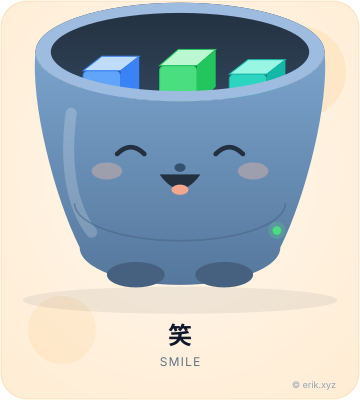 `:oss-smile:` · 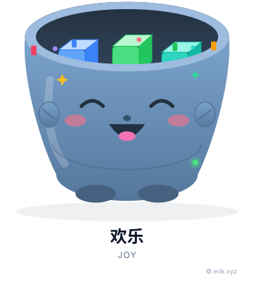 `:oss-joy:` · 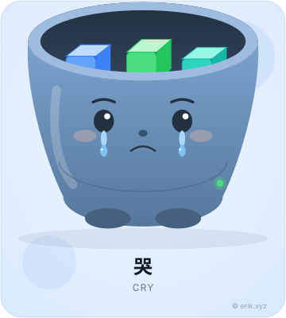 `:oss-cry:` ·  `:oss-depressed:` ·  `:oss-terrified:` ·  `:oss-angry:`

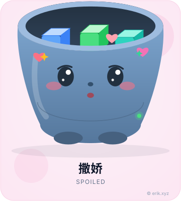 `:oss-coquettish:` · 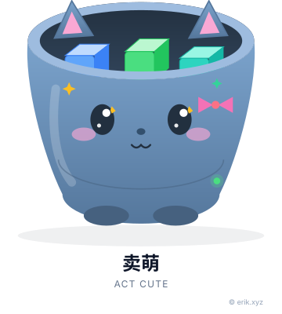 `:oss-cute:` · 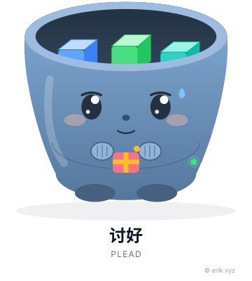 `:oss-pleasing:` · 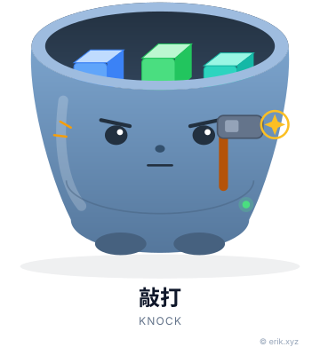 `:oss-knocking:` · 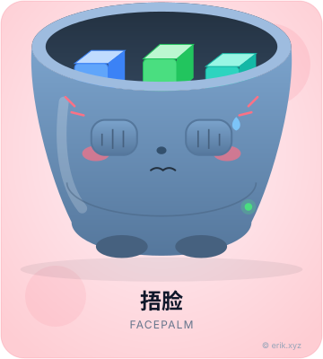 `:oss-facepalm:` · 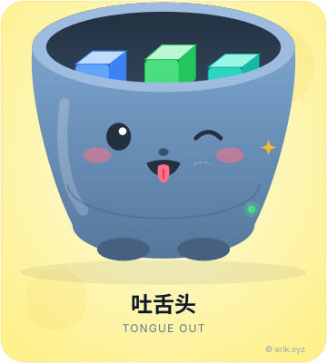 `:oss-tongue:`

### Pax · `polypack` · `:polypack-*:`

 `:polypack-smile:` ·  `:polypack-joy:` ·  `:polypack-cry:` ·  `:polypack-depressed:` ·  `:polypack-terrified:` ·  `:polypack-angry:`

 `:polypack-coquettish:` ·  `:polypack-cute:` ·  `:polypack-pleasing:` ·  `:polypack-knocking:` ·  `:polypack-facepalm:` ·  `:polypack-tongue:`

### 小欧 · `opi` · `:opi-*:`

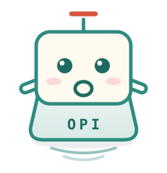 `:opi-smile:` · 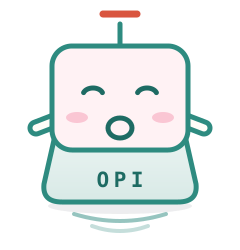 `:opi-joy:` · 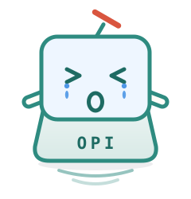 `:opi-cry:` · 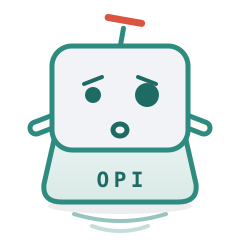 `:opi-depressed:` · 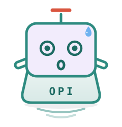 `:opi-terrified:` · 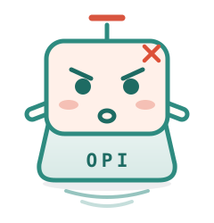 `:opi-angry:`

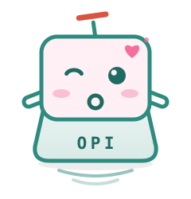 `:opi-coquettish:` · 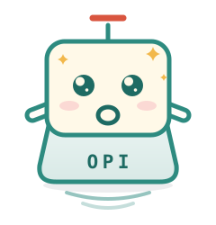 `:opi-cute:` · 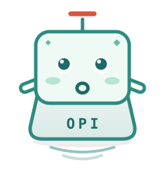 `:opi-pleasing:` · 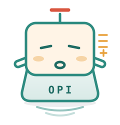 `:opi-knocking:` · 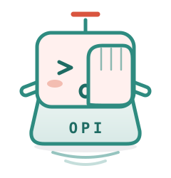 `:opi-facepalm:` · 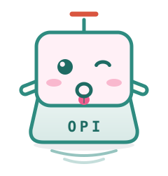 `:opi-tongue:`

## 说明

- 图片源文件在 `pets/<项目>/<形态>.svg`，PNG 在 `png/<项目>/<形态>.png`。
- `preview.png` 是所有项目「笑」形态的总览。
- 已去除与其他项目重复的 7 个宠物入口：`aetherupload-rust`、`apidoc-go`、`apidoc-rust`、`apidoc-ui`、`encryptable-rust`、`hashids-rust`、`snowflake-rust`；保留对应的 PHP / Webman 版本。`jwt-rust` 已改为独立橘猫形象，重新纳入。
- 本项目代码与生成脚本仍遵循其原有许可；视觉资产适用 [ASSETS-LICENSE.md](ASSETS-LICENSE.md)。
