# 项目宠物 Emoji 图鉴 · Pet Emoji Atlas

**56 个项目 × 12 种形态 = 672 枚宠物表情 emoji。**
每一枚同时提供 **图片（SVG / PNG）+ 彩色字体（CBDT/CBLC TTF）+ 短码（shortcode）**。

> **授权 / License**：本项目中的项目宠物、图片、图标、表情及字体中的图形字形均为
> **非开源资产**，商业使用需取得商业授权。详见 [ASSETS-LICENSE.md](ASSETS-LICENSE.md)。

## 12 种形态

笑 / 欢乐 / 哭 / 沮丧 / 惊恐 / 愤怒 / 撒娇 / 卖萌 / 讨好 / 敲打 / 捂脸 / 吐舌头

## 用法

### 1. 图片

```html

```

### 2. 字体

```html
<link rel="stylesheet" href="font/emoji.css">
<span class="mood-emoji">&#xE000;</span>
```

字体为 CBDT/CBLC 彩色位图字体；支持彩色位图字体的环境会显示对应宠物表情，否则请使用图片。

### 3. 短码

```html
<span class="mood-emoji">:ads-php-smile:</span>
<span class="mood-emoji">:emoji-ads-php-smile:</span>
```

- 主短码：`:<项目>-<形态>:`
- 别名：`:emoji-<项目>-<形态>:`
- 字体码位：`U+E000..U+E29F`
- 全量映射见 [shortcodes.json](shortcodes.json)；字体内置主短码 `:<项目>-<形态>:` 的 `liga` 连字。
- `:emoji-<项目>-<形态>:` 别名可用 `shortcodes.json` 映射为图片或对应码位；需要把短码渲染成图片时，查 `image` 字段。

## 项目总览

| # | 宠物 | 项目 | 短码前缀 | 形态 |
|---|---|---|---|---|
| 1 | 阿章 | `ads-php` | `:ads-php-*:` | 12 |
| 2 | 小约 | `appointment-php` | `:appointment-php-*:` | 12 |
| 3 | Rusty | `bee-rust` | `:bee-rust-*:` | 12 |
| 4 | 阿守 | `bee-rust-admin` | `:bee-rust-admin-*:` | 12 |
| 5 | 云团 | `cloud-php` | `:cloud-php-*:` | 12 |
| 6 | E-Cat | `e-cat` | `:e-cat-*:` | 12 |
| 7 | Loupi | `erik-talk` | `:erik-talk-*:` | 12 |
| 8 | 小八爪 | `erp-php` | `:erp-php-*:` | 12 |
| 9 | Dicey | `game-platform-php` | `:game-platform-php-*:` | 12 |
| 10 | 霜霜 | `insurance-service` | `:insurance-service-*:` | 12 |
| 11 | E-Cat | `integrated-global-logistics` | `:integrated-global-logistics-*:` | 12 |
| 12 | IoT Bot | `iot-platform` | `:iot-platform-*:` | 12 |
| 13 | 租租鼠 | `item-rental` | `:item-rental-*:` | 12 |
| 14 | 小音机 | `omb` | `:omb-*:` | 12 |
| 15 | 小安 | `open-admin` | `:open-admin-*:` | 12 |
| 16 | Novi | `open-novel` | `:open-novel-*:` | 12 |
| 17 | 南南 | `open-travel` | `:open-travel-*:` | 12 |
| 18 | 小筑 | `property-management-platform` | `:property-management-platform-*:` | 12 |
| 19 | 算子 | `quantitative-trading` | `:quantitative-trading-*:` | 12 |
| 20 | 雪球 Snowy | `shop-php` | `:shop-php-*:` | 12 |
| 21 | Bub | `social` | `:social-*:` | 12 |
| 22 | ssd | `ssd` | `:ssd-*:` | 12 |
| 23 | 超猫 SuperCat | `super-ops` | `:super-ops-*:` | 12 |
| 24 | 以太兽 | `bag/aetherupload-rust` | `:aetherupload-rust-*:` | 12 |
| 25 | Apidoc | `bag/apidoc-go` | `:apidoc-go-*:` | 12 |
| 26 | Apidoc | `bag/apidoc-rust` | `:apidoc-rust-*:` | 12 |
| 27 | 小运 | `bag/canal` | `:canal-*:` | 12 |
| 28 | 小德 | `bag/druid-rust` | `:druid-rust-*:` | 12 |
| 29 | Locky | `bag/encryptable-rust` | `:encryptable-rust-*:` | 12 |
| 30 | Locky | `bag/encryption-rust` | `:encryption-rust-*:` | 12 |
| 31 | 小侦 Scouty | `bag/go-scout` | `:go-scout-*:` | 12 |
| 32 | 哈希迪 Hashy | `bag/hashids-rust` | `:hashids-rust-*:` | 12 |
| 33 | 钥匙小卫 Kee | `bag/jwt-rust` | `:jwt-rust-*:` | 12 |
| 34 | Posty | `bag/poster-rust` | `:poster-rust-*:` | 12 |
| 35 | Scout | `bag/rust-scout` | `:rust-scout-*:` | 12 |
| 36 | 哨兵鼠 | `bag/security-go` | `:security-go-*:` | 12 |
| 37 | 甲哨 Sentri | `bag/security-rust` | `:security-rust-*:` | 12 |
| 38 | 雪花精灵 | `bag/snowflake-rust` | `:snowflake-rust-*:` | 12 |
| 39 | 以太兽 | `erikwang2013/aetherupload-webman` | `:aetherupload-webman-*:` | 12 |
| 40 | Apidoc | `erikwang2013/apidoc-php` | `:apidoc-php-*:` | 12 |
| 41 | Apidoc UI | `erikwang2013/apidoc-ui` | `:apidoc-ui-*:` | 12 |
| 42 | ClickHouse 小象 | `erikwang2013/clickhouse-php` | `:clickhouse-php-*:` | 12 |
| 43 | Consu | `erikwang2013/consul-php` | `:consul-php-*:` | 12 |
| 44 | Locky | `erikwang2013/encryptable` | `:encryptable-*:` | 12 |
| 45 | Locky | `erikwang2013/encryption` | `:encryption-*:` | 12 |
| 46 | Etchy | `erikwang2013/etcd` | `:etcd-*:` | 12 |
| 47 | 哈希迪 Hashy | `erikwang2013/hashids` | `:hashids-*:` | 12 |
| 48 | 钥匙小卫 Kee | `erikwang2013/jwt-webman` | `:jwt-webman-*:` | 12 |
| 49 | Posty | `erikwang2013/poster-php` | `:poster-php-*:` | 12 |
| 50 | Seasony 季灵 | `erikwang2013/season` | `:season-*:` | 12 |
| 51 | 小盾 | `erikwang2013/security-php` | `:security-php-*:` | 12 |
| 52 | 雪花精灵 | `erikwang2013/snowflake-php` | `:snowflake-php-*:` | 12 |
| 53 | Sniffy | `erikwang2013/webman-scout` | `:webman-scout-*:` | 12 |
| 54 | Xhpy | `erikwang2013/xhprof` | `:xhprof-*:` | 12 |
| 55 | 焰焰 | `erikwang2013/xhprof-webman` | `:xhprof-webman-*:` | 12 |
| 56 | Pax | `polypack` | `:polypack-*:` | 12 |

## 逐项目预览

<details>
<summary><b>阿章</b> · <code>ads-php</code> · <code>:ads-php-*:</code></summary>

<table align="center">
<tr><td align="center"><br><b>笑</b><br><code>:ads-php-smile:</code></td><td align="center"><br><b>欢乐</b><br><code>:ads-php-joy:</code></td><td align="center"><br><b>哭</b><br><code>:ads-php-cry:</code></td><td align="center"><br><b>沮丧</b><br><code>:ads-php-depressed:</code></td><td align="center"><br><b>惊恐</b><br><code>:ads-php-terrified:</code></td><td align="center"><br><b>愤怒</b><br><code>:ads-php-angry:</code></td></tr>
<tr><td align="center"><br><b>撒娇</b><br><code>:ads-php-coquettish:</code></td><td align="center"><br><b>卖萌</b><br><code>:ads-php-cute:</code></td><td align="center"><br><b>讨好</b><br><code>:ads-php-pleasing:</code></td><td align="center"><br><b>敲打</b><br><code>:ads-php-knocking:</code></td><td align="center"><br><b>捂脸</b><br><code>:ads-php-facepalm:</code></td><td align="center"><br><b>吐舌头</b><br><code>:ads-php-tongue:</code></td></tr>
</table>

</details>
<details>
<summary><b>小约</b> · <code>appointment-php</code> · <code>:appointment-php-*:</code></summary>

<table align="center">
<tr><td align="center"><br><b>笑</b><br><code>:appointment-php-smile:</code></td><td align="center"><br><b>欢乐</b><br><code>:appointment-php-joy:</code></td><td align="center"><br><b>哭</b><br><code>:appointment-php-cry:</code></td><td align="center"><br><b>沮丧</b><br><code>:appointment-php-depressed:</code></td><td align="center"><br><b>惊恐</b><br><code>:appointment-php-terrified:</code></td><td align="center"><br><b>愤怒</b><br><code>:appointment-php-angry:</code></td></tr>
<tr><td align="center"><br><b>撒娇</b><br><code>:appointment-php-coquettish:</code></td><td align="center"><br><b>卖萌</b><br><code>:appointment-php-cute:</code></td><td align="center"><br><b>讨好</b><br><code>:appointment-php-pleasing:</code></td><td align="center"><br><b>敲打</b><br><code>:appointment-php-knocking:</code></td><td align="center"><br><b>捂脸</b><br><code>:appointment-php-facepalm:</code></td><td align="center"><br><b>吐舌头</b><br><code>:appointment-php-tongue:</code></td></tr>
</table>

</details>
<details>
<summary><b>Rusty</b> · <code>bee-rust</code> · <code>:bee-rust-*:</code></summary>

<table align="center">
<tr><td align="center"><br><b>笑</b><br><code>:bee-rust-smile:</code></td><td align="center"><br><b>欢乐</b><br><code>:bee-rust-joy:</code></td><td align="center"><br><b>哭</b><br><code>:bee-rust-cry:</code></td><td align="center"><br><b>沮丧</b><br><code>:bee-rust-depressed:</code></td><td align="center"><br><b>惊恐</b><br><code>:bee-rust-terrified:</code></td><td align="center"><br><b>愤怒</b><br><code>:bee-rust-angry:</code></td></tr>
<tr><td align="center"><br><b>撒娇</b><br><code>:bee-rust-coquettish:</code></td><td align="center"><br><b>卖萌</b><br><code>:bee-rust-cute:</code></td><td align="center"><br><b>讨好</b><br><code>:bee-rust-pleasing:</code></td><td align="center"><br><b>敲打</b><br><code>:bee-rust-knocking:</code></td><td align="center"><br><b>捂脸</b><br><code>:bee-rust-facepalm:</code></td><td align="center"><br><b>吐舌头</b><br><code>:bee-rust-tongue:</code></td></tr>
</table>

</details>
<details>
<summary><b>阿守</b> · <code>bee-rust-admin</code> · <code>:bee-rust-admin-*:</code></summary>

<table align="center">
<tr><td align="center"><br><b>笑</b><br><code>:bee-rust-admin-smile:</code></td><td align="center"><br><b>欢乐</b><br><code>:bee-rust-admin-joy:</code></td><td align="center"><br><b>哭</b><br><code>:bee-rust-admin-cry:</code></td><td align="center"><br><b>沮丧</b><br><code>:bee-rust-admin-depressed:</code></td><td align="center"><br><b>惊恐</b><br><code>:bee-rust-admin-terrified:</code></td><td align="center"><br><b>愤怒</b><br><code>:bee-rust-admin-angry:</code></td></tr>
<tr><td align="center"><br><b>撒娇</b><br><code>:bee-rust-admin-coquettish:</code></td><td align="center"><br><b>卖萌</b><br><code>:bee-rust-admin-cute:</code></td><td align="center"><br><b>讨好</b><br><code>:bee-rust-admin-pleasing:</code></td><td align="center"><br><b>敲打</b><br><code>:bee-rust-admin-knocking:</code></td><td align="center"><br><b>捂脸</b><br><code>:bee-rust-admin-facepalm:</code></td><td align="center"><br><b>吐舌头</b><br><code>:bee-rust-admin-tongue:</code></td></tr>
</table>

</details>
<details>
<summary><b>云团</b> · <code>cloud-php</code> · <code>:cloud-php-*:</code></summary>

<table align="center">
<tr><td align="center"><br><b>笑</b><br><code>:cloud-php-smile:</code></td><td align="center"><br><b>欢乐</b><br><code>:cloud-php-joy:</code></td><td align="center"><br><b>哭</b><br><code>:cloud-php-cry:</code></td><td align="center"><br><b>沮丧</b><br><code>:cloud-php-depressed:</code></td><td align="center"><br><b>惊恐</b><br><code>:cloud-php-terrified:</code></td><td align="center"><br><b>愤怒</b><br><code>:cloud-php-angry:</code></td></tr>
<tr><td align="center"><br><b>撒娇</b><br><code>:cloud-php-coquettish:</code></td><td align="center"><br><b>卖萌</b><br><code>:cloud-php-cute:</code></td><td align="center"><br><b>讨好</b><br><code>:cloud-php-pleasing:</code></td><td align="center"><br><b>敲打</b><br><code>:cloud-php-knocking:</code></td><td align="center"><br><b>捂脸</b><br><code>:cloud-php-facepalm:</code></td><td align="center"><br><b>吐舌头</b><br><code>:cloud-php-tongue:</code></td></tr>
</table>

</details>
<details>
<summary><b>E-Cat</b> · <code>e-cat</code> · <code>:e-cat-*:</code></summary>

<table align="center">
<tr><td align="center"><br><b>笑</b><br><code>:e-cat-smile:</code></td><td align="center"><br><b>欢乐</b><br><code>:e-cat-joy:</code></td><td align="center"><br><b>哭</b><br><code>:e-cat-cry:</code></td><td align="center"><br><b>沮丧</b><br><code>:e-cat-depressed:</code></td><td align="center"><br><b>惊恐</b><br><code>:e-cat-terrified:</code></td><td align="center"><br><b>愤怒</b><br><code>:e-cat-angry:</code></td></tr>
<tr><td align="center"><br><b>撒娇</b><br><code>:e-cat-coquettish:</code></td><td align="center"><br><b>卖萌</b><br><code>:e-cat-cute:</code></td><td align="center"><br><b>讨好</b><br><code>:e-cat-pleasing:</code></td><td align="center"><br><b>敲打</b><br><code>:e-cat-knocking:</code></td><td align="center"><br><b>捂脸</b><br><code>:e-cat-facepalm:</code></td><td align="center"><br><b>吐舌头</b><br><code>:e-cat-tongue:</code></td></tr>
</table>

</details>
<details>
<summary><b>Loupi</b> · <code>erik-talk</code> · <code>:erik-talk-*:</code></summary>

<table align="center">
<tr><td align="center"><br><b>笑</b><br><code>:erik-talk-smile:</code></td><td align="center"><br><b>欢乐</b><br><code>:erik-talk-joy:</code></td><td align="center"><br><b>哭</b><br><code>:erik-talk-cry:</code></td><td align="center"><br><b>沮丧</b><br><code>:erik-talk-depressed:</code></td><td align="center"><br><b>惊恐</b><br><code>:erik-talk-terrified:</code></td><td align="center"><br><b>愤怒</b><br><code>:erik-talk-angry:</code></td></tr>
<tr><td align="center"><br><b>撒娇</b><br><code>:erik-talk-coquettish:</code></td><td align="center"><br><b>卖萌</b><br><code>:erik-talk-cute:</code></td><td align="center"><br><b>讨好</b><br><code>:erik-talk-pleasing:</code></td><td align="center"><br><b>敲打</b><br><code>:erik-talk-knocking:</code></td><td align="center"><br><b>捂脸</b><br><code>:erik-talk-facepalm:</code></td><td align="center"><br><b>吐舌头</b><br><code>:erik-talk-tongue:</code></td></tr>
</table>

</details>
<details>
<summary><b>小八爪</b> · <code>erp-php</code> · <code>:erp-php-*:</code></summary>

<table align="center">
<tr><td align="center"><br><b>笑</b><br><code>:erp-php-smile:</code></td><td align="center"><br><b>欢乐</b><br><code>:erp-php-joy:</code></td><td align="center"><br><b>哭</b><br><code>:erp-php-cry:</code></td><td align="center"><br><b>沮丧</b><br><code>:erp-php-depressed:</code></td><td align="center"><br><b>惊恐</b><br><code>:erp-php-terrified:</code></td><td align="center"><br><b>愤怒</b><br><code>:erp-php-angry:</code></td></tr>
<tr><td align="center"><br><b>撒娇</b><br><code>:erp-php-coquettish:</code></td><td align="center"><br><b>卖萌</b><br><code>:erp-php-cute:</code></td><td align="center"><br><b>讨好</b><br><code>:erp-php-pleasing:</code></td><td align="center"><br><b>敲打</b><br><code>:erp-php-knocking:</code></td><td align="center"><br><b>捂脸</b><br><code>:erp-php-facepalm:</code></td><td align="center"><br><b>吐舌头</b><br><code>:erp-php-tongue:</code></td></tr>
</table>

</details>
<details>
<summary><b>Dicey</b> · <code>game-platform-php</code> · <code>:game-platform-php-*:</code></summary>

<table align="center">
<tr><td align="center"><br><b>笑</b><br><code>:game-platform-php-smile:</code></td><td align="center"><br><b>欢乐</b><br><code>:game-platform-php-joy:</code></td><td align="center"><br><b>哭</b><br><code>:game-platform-php-cry:</code></td><td align="center"><br><b>沮丧</b><br><code>:game-platform-php-depressed:</code></td><td align="center"><br><b>惊恐</b><br><code>:game-platform-php-terrified:</code></td><td align="center"><br><b>愤怒</b><br><code>:game-platform-php-angry:</code></td></tr>
<tr><td align="center"><br><b>撒娇</b><br><code>:game-platform-php-coquettish:</code></td><td align="center"><br><b>卖萌</b><br><code>:game-platform-php-cute:</code></td><td align="center"><br><b>讨好</b><br><code>:game-platform-php-pleasing:</code></td><td align="center"><br><b>敲打</b><br><code>:game-platform-php-knocking:</code></td><td align="center"><br><b>捂脸</b><br><code>:game-platform-php-facepalm:</code></td><td align="center"><br><b>吐舌头</b><br><code>:game-platform-php-tongue:</code></td></tr>
</table>

</details>
<details>
<summary><b>霜霜</b> · <code>insurance-service</code> · <code>:insurance-service-*:</code></summary>

<table align="center">
<tr><td align="center"><br><b>笑</b><br><code>:insurance-service-smile:</code></td><td align="center"><br><b>欢乐</b><br><code>:insurance-service-joy:</code></td><td align="center"><br><b>哭</b><br><code>:insurance-service-cry:</code></td><td align="center"><br><b>沮丧</b><br><code>:insurance-service-depressed:</code></td><td align="center"><br><b>惊恐</b><br><code>:insurance-service-terrified:</code></td><td align="center"><br><b>愤怒</b><br><code>:insurance-service-angry:</code></td></tr>
<tr><td align="center"><br><b>撒娇</b><br><code>:insurance-service-coquettish:</code></td><td align="center"><br><b>卖萌</b><br><code>:insurance-service-cute:</code></td><td align="center"><br><b>讨好</b><br><code>:insurance-service-pleasing:</code></td><td align="center"><br><b>敲打</b><br><code>:insurance-service-knocking:</code></td><td align="center"><br><b>捂脸</b><br><code>:insurance-service-facepalm:</code></td><td align="center"><br><b>吐舌头</b><br><code>:insurance-service-tongue:</code></td></tr>
</table>

</details>
<details>
<summary><b>E-Cat</b> · <code>integrated-global-logistics</code> · <code>:integrated-global-logistics-*:</code></summary>

<table align="center">
<tr><td align="center"><br><b>笑</b><br><code>:integrated-global-logistics-smile:</code></td><td align="center"><br><b>欢乐</b><br><code>:integrated-global-logistics-joy:</code></td><td align="center"><br><b>哭</b><br><code>:integrated-global-logistics-cry:</code></td><td align="center"><br><b>沮丧</b><br><code>:integrated-global-logistics-depressed:</code></td><td align="center"><br><b>惊恐</b><br><code>:integrated-global-logistics-terrified:</code></td><td align="center"><br><b>愤怒</b><br><code>:integrated-global-logistics-angry:</code></td></tr>
<tr><td align="center"><br><b>撒娇</b><br><code>:integrated-global-logistics-coquettish:</code></td><td align="center"><br><b>卖萌</b><br><code>:integrated-global-logistics-cute:</code></td><td align="center"><br><b>讨好</b><br><code>:integrated-global-logistics-pleasing:</code></td><td align="center"><br><b>敲打</b><br><code>:integrated-global-logistics-knocking:</code></td><td align="center"><br><b>捂脸</b><br><code>:integrated-global-logistics-facepalm:</code></td><td align="center"><br><b>吐舌头</b><br><code>:integrated-global-logistics-tongue:</code></td></tr>
</table>

</details>
<details>
<summary><b>IoT Bot</b> · <code>iot-platform</code> · <code>:iot-platform-*:</code></summary>

<table align="center">
<tr><td align="center"><br><b>笑</b><br><code>:iot-platform-smile:</code></td><td align="center"><br><b>欢乐</b><br><code>:iot-platform-joy:</code></td><td align="center"><br><b>哭</b><br><code>:iot-platform-cry:</code></td><td align="center"><br><b>沮丧</b><br><code>:iot-platform-depressed:</code></td><td align="center"><br><b>惊恐</b><br><code>:iot-platform-terrified:</code></td><td align="center"><br><b>愤怒</b><br><code>:iot-platform-angry:</code></td></tr>
<tr><td align="center"><br><b>撒娇</b><br><code>:iot-platform-coquettish:</code></td><td align="center"><br><b>卖萌</b><br><code>:iot-platform-cute:</code></td><td align="center"><br><b>讨好</b><br><code>:iot-platform-pleasing:</code></td><td align="center"><br><b>敲打</b><br><code>:iot-platform-knocking:</code></td><td align="center"><br><b>捂脸</b><br><code>:iot-platform-facepalm:</code></td><td align="center"><br><b>吐舌头</b><br><code>:iot-platform-tongue:</code></td></tr>
</table>

</details>
<details>
<summary><b>租租鼠</b> · <code>item-rental</code> · <code>:item-rental-*:</code></summary>

<table align="center">
<tr><td align="center"><br><b>笑</b><br><code>:item-rental-smile:</code></td><td align="center"><br><b>欢乐</b><br><code>:item-rental-joy:</code></td><td align="center"><br><b>哭</b><br><code>:item-rental-cry:</code></td><td align="center"><br><b>沮丧</b><br><code>:item-rental-depressed:</code></td><td align="center"><br><b>惊恐</b><br><code>:item-rental-terrified:</code></td><td align="center"><br><b>愤怒</b><br><code>:item-rental-angry:</code></td></tr>
<tr><td align="center"><br><b>撒娇</b><br><code>:item-rental-coquettish:</code></td><td align="center"><br><b>卖萌</b><br><code>:item-rental-cute:</code></td><td align="center"><br><b>讨好</b><br><code>:item-rental-pleasing:</code></td><td align="center"><br><b>敲打</b><br><code>:item-rental-knocking:</code></td><td align="center"><br><b>捂脸</b><br><code>:item-rental-facepalm:</code></td><td align="center"><br><b>吐舌头</b><br><code>:item-rental-tongue:</code></td></tr>
</table>

</details>
<details>
<summary><b>小音机</b> · <code>omb</code> · <code>:omb-*:</code></summary>

<table align="center">
<tr><td align="center"><br><b>笑</b><br><code>:omb-smile:</code></td><td align="center"><br><b>欢乐</b><br><code>:omb-joy:</code></td><td align="center"><br><b>哭</b><br><code>:omb-cry:</code></td><td align="center"><br><b>沮丧</b><br><code>:omb-depressed:</code></td><td align="center"><br><b>惊恐</b><br><code>:omb-terrified:</code></td><td align="center"><br><b>愤怒</b><br><code>:omb-angry:</code></td></tr>
<tr><td align="center"><br><b>撒娇</b><br><code>:omb-coquettish:</code></td><td align="center"><br><b>卖萌</b><br><code>:omb-cute:</code></td><td align="center"><br><b>讨好</b><br><code>:omb-pleasing:</code></td><td align="center"><br><b>敲打</b><br><code>:omb-knocking:</code></td><td align="center"><br><b>捂脸</b><br><code>:omb-facepalm:</code></td><td align="center"><br><b>吐舌头</b><br><code>:omb-tongue:</code></td></tr>
</table>

</details>
<details>
<summary><b>小安</b> · <code>open-admin</code> · <code>:open-admin-*:</code></summary>

<table align="center">
<tr><td align="center"><br><b>笑</b><br><code>:open-admin-smile:</code></td><td align="center"><br><b>欢乐</b><br><code>:open-admin-joy:</code></td><td align="center"><br><b>哭</b><br><code>:open-admin-cry:</code></td><td align="center"><br><b>沮丧</b><br><code>:open-admin-depressed:</code></td><td align="center"><br><b>惊恐</b><br><code>:open-admin-terrified:</code></td><td align="center"><br><b>愤怒</b><br><code>:open-admin-angry:</code></td></tr>
<tr><td align="center"><br><b>撒娇</b><br><code>:open-admin-coquettish:</code></td><td align="center"><br><b>卖萌</b><br><code>:open-admin-cute:</code></td><td align="center"><br><b>讨好</b><br><code>:open-admin-pleasing:</code></td><td align="center"><br><b>敲打</b><br><code>:open-admin-knocking:</code></td><td align="center"><br><b>捂脸</b><br><code>:open-admin-facepalm:</code></td><td align="center"><br><b>吐舌头</b><br><code>:open-admin-tongue:</code></td></tr>
</table>

</details>
<details>
<summary><b>Novi</b> · <code>open-novel</code> · <code>:open-novel-*:</code></summary>

<table align="center">
<tr><td align="center"><br><b>笑</b><br><code>:open-novel-smile:</code></td><td align="center"><br><b>欢乐</b><br><code>:open-novel-joy:</code></td><td align="center"><br><b>哭</b><br><code>:open-novel-cry:</code></td><td align="center"><br><b>沮丧</b><br><code>:open-novel-depressed:</code></td><td align="center"><br><b>惊恐</b><br><code>:open-novel-terrified:</code></td><td align="center"><br><b>愤怒</b><br><code>:open-novel-angry:</code></td></tr>
<tr><td align="center"><br><b>撒娇</b><br><code>:open-novel-coquettish:</code></td><td align="center"><br><b>卖萌</b><br><code>:open-novel-cute:</code></td><td align="center"><br><b>讨好</b><br><code>:open-novel-pleasing:</code></td><td align="center"><br><b>敲打</b><br><code>:open-novel-knocking:</code></td><td align="center"><br><b>捂脸</b><br><code>:open-novel-facepalm:</code></td><td align="center"><br><b>吐舌头</b><br><code>:open-novel-tongue:</code></td></tr>
</table>

</details>
<details>
<summary><b>南南</b> · <code>open-travel</code> · <code>:open-travel-*:</code></summary>

<table align="center">
<tr><td align="center"><br><b>笑</b><br><code>:open-travel-smile:</code></td><td align="center"><br><b>欢乐</b><br><code>:open-travel-joy:</code></td><td align="center"><br><b>哭</b><br><code>:open-travel-cry:</code></td><td align="center"><br><b>沮丧</b><br><code>:open-travel-depressed:</code></td><td align="center"><br><b>惊恐</b><br><code>:open-travel-terrified:</code></td><td align="center"><br><b>愤怒</b><br><code>:open-travel-angry:</code></td></tr>
<tr><td align="center"><br><b>撒娇</b><br><code>:open-travel-coquettish:</code></td><td align="center"><br><b>卖萌</b><br><code>:open-travel-cute:</code></td><td align="center"><br><b>讨好</b><br><code>:open-travel-pleasing:</code></td><td align="center"><br><b>敲打</b><br><code>:open-travel-knocking:</code></td><td align="center"><br><b>捂脸</b><br><code>:open-travel-facepalm:</code></td><td align="center"><br><b>吐舌头</b><br><code>:open-travel-tongue:</code></td></tr>
</table>

</details>
<details>
<summary><b>小筑</b> · <code>property-management-platform</code> · <code>:property-management-platform-*:</code></summary>

<table align="center">
<tr><td align="center"><br><b>笑</b><br><code>:property-management-platform-smile:</code></td><td align="center"><br><b>欢乐</b><br><code>:property-management-platform-joy:</code></td><td align="center"><br><b>哭</b><br><code>:property-management-platform-cry:</code></td><td align="center"><br><b>沮丧</b><br><code>:property-management-platform-depressed:</code></td><td align="center"><br><b>惊恐</b><br><code>:property-management-platform-terrified:</code></td><td align="center"><br><b>愤怒</b><br><code>:property-management-platform-angry:</code></td></tr>
<tr><td align="center"><br><b>撒娇</b><br><code>:property-management-platform-coquettish:</code></td><td align="center"><br><b>卖萌</b><br><code>:property-management-platform-cute:</code></td><td align="center"><br><b>讨好</b><br><code>:property-management-platform-pleasing:</code></td><td align="center"><br><b>敲打</b><br><code>:property-management-platform-knocking:</code></td><td align="center"><br><b>捂脸</b><br><code>:property-management-platform-facepalm:</code></td><td align="center"><br><b>吐舌头</b><br><code>:property-management-platform-tongue:</code></td></tr>
</table>

</details>
<details>
<summary><b>算子</b> · <code>quantitative-trading</code> · <code>:quantitative-trading-*:</code></summary>

<table align="center">
<tr><td align="center"><br><b>笑</b><br><code>:quantitative-trading-smile:</code></td><td align="center"><br><b>欢乐</b><br><code>:quantitative-trading-joy:</code></td><td align="center"><br><b>哭</b><br><code>:quantitative-trading-cry:</code></td><td align="center"><br><b>沮丧</b><br><code>:quantitative-trading-depressed:</code></td><td align="center"><br><b>惊恐</b><br><code>:quantitative-trading-terrified:</code></td><td align="center"><br><b>愤怒</b><br><code>:quantitative-trading-angry:</code></td></tr>
<tr><td align="center"><br><b>撒娇</b><br><code>:quantitative-trading-coquettish:</code></td><td align="center"><br><b>卖萌</b><br><code>:quantitative-trading-cute:</code></td><td align="center"><br><b>讨好</b><br><code>:quantitative-trading-pleasing:</code></td><td align="center"><br><b>敲打</b><br><code>:quantitative-trading-knocking:</code></td><td align="center"><br><b>捂脸</b><br><code>:quantitative-trading-facepalm:</code></td><td align="center"><br><b>吐舌头</b><br><code>:quantitative-trading-tongue:</code></td></tr>
</table>

</details>
<details>
<summary><b>雪球 Snowy</b> · <code>shop-php</code> · <code>:shop-php-*:</code></summary>

<table align="center">
<tr><td align="center"><br><b>笑</b><br><code>:shop-php-smile:</code></td><td align="center"><br><b>欢乐</b><br><code>:shop-php-joy:</code></td><td align="center"><br><b>哭</b><br><code>:shop-php-cry:</code></td><td align="center"><br><b>沮丧</b><br><code>:shop-php-depressed:</code></td><td align="center"><br><b>惊恐</b><br><code>:shop-php-terrified:</code></td><td align="center"><br><b>愤怒</b><br><code>:shop-php-angry:</code></td></tr>
<tr><td align="center"><br><b>撒娇</b><br><code>:shop-php-coquettish:</code></td><td align="center"><br><b>卖萌</b><br><code>:shop-php-cute:</code></td><td align="center"><br><b>讨好</b><br><code>:shop-php-pleasing:</code></td><td align="center"><br><b>敲打</b><br><code>:shop-php-knocking:</code></td><td align="center"><br><b>捂脸</b><br><code>:shop-php-facepalm:</code></td><td align="center"><br><b>吐舌头</b><br><code>:shop-php-tongue:</code></td></tr>
</table>

</details>
<details>
<summary><b>Bub</b> · <code>social</code> · <code>:social-*:</code></summary>

<table align="center">
<tr><td align="center"><br><b>笑</b><br><code>:social-smile:</code></td><td align="center"><br><b>欢乐</b><br><code>:social-joy:</code></td><td align="center"><br><b>哭</b><br><code>:social-cry:</code></td><td align="center"><br><b>沮丧</b><br><code>:social-depressed:</code></td><td align="center"><br><b>惊恐</b><br><code>:social-terrified:</code></td><td align="center"><br><b>愤怒</b><br><code>:social-angry:</code></td></tr>
<tr><td align="center"><br><b>撒娇</b><br><code>:social-coquettish:</code></td><td align="center"><br><b>卖萌</b><br><code>:social-cute:</code></td><td align="center"><br><b>讨好</b><br><code>:social-pleasing:</code></td><td align="center"><br><b>敲打</b><br><code>:social-knocking:</code></td><td align="center"><br><b>捂脸</b><br><code>:social-facepalm:</code></td><td align="center"><br><b>吐舌头</b><br><code>:social-tongue:</code></td></tr>
</table>

</details>
<details>
<summary><b>ssd</b> · <code>ssd</code> · <code>:ssd-*:</code></summary>

<table align="center">
<tr><td align="center"><br><b>笑</b><br><code>:ssd-smile:</code></td><td align="center"><br><b>欢乐</b><br><code>:ssd-joy:</code></td><td align="center"><br><b>哭</b><br><code>:ssd-cry:</code></td><td align="center"><br><b>沮丧</b><br><code>:ssd-depressed:</code></td><td align="center"><br><b>惊恐</b><br><code>:ssd-terrified:</code></td><td align="center"><br><b>愤怒</b><br><code>:ssd-angry:</code></td></tr>
<tr><td align="center"><br><b>撒娇</b><br><code>:ssd-coquettish:</code></td><td align="center"><br><b>卖萌</b><br><code>:ssd-cute:</code></td><td align="center"><br><b>讨好</b><br><code>:ssd-pleasing:</code></td><td align="center"><br><b>敲打</b><br><code>:ssd-knocking:</code></td><td align="center"><br><b>捂脸</b><br><code>:ssd-facepalm:</code></td><td align="center"><br><b>吐舌头</b><br><code>:ssd-tongue:</code></td></tr>
</table>

</details>
<details>
<summary><b>超猫 SuperCat</b> · <code>super-ops</code> · <code>:super-ops-*:</code></summary>

<table align="center">
<tr><td align="center"><br><b>笑</b><br><code>:super-ops-smile:</code></td><td align="center"><br><b>欢乐</b><br><code>:super-ops-joy:</code></td><td align="center"><br><b>哭</b><br><code>:super-ops-cry:</code></td><td align="center"><br><b>沮丧</b><br><code>:super-ops-depressed:</code></td><td align="center"><br><b>惊恐</b><br><code>:super-ops-terrified:</code></td><td align="center"><br><b>愤怒</b><br><code>:super-ops-angry:</code></td></tr>
<tr><td align="center"><br><b>撒娇</b><br><code>:super-ops-coquettish:</code></td><td align="center"><br><b>卖萌</b><br><code>:super-ops-cute:</code></td><td align="center"><br><b>讨好</b><br><code>:super-ops-pleasing:</code></td><td align="center"><br><b>敲打</b><br><code>:super-ops-knocking:</code></td><td align="center"><br><b>捂脸</b><br><code>:super-ops-facepalm:</code></td><td align="center"><br><b>吐舌头</b><br><code>:super-ops-tongue:</code></td></tr>
</table>

</details>
<details>
<summary><b>以太兽</b> · <code>bag/aetherupload-rust</code> · <code>:aetherupload-rust-*:</code></summary>

<table align="center">
<tr><td align="center"><br><b>笑</b><br><code>:aetherupload-rust-smile:</code></td><td align="center"><br><b>欢乐</b><br><code>:aetherupload-rust-joy:</code></td><td align="center"><br><b>哭</b><br><code>:aetherupload-rust-cry:</code></td><td align="center"><br><b>沮丧</b><br><code>:aetherupload-rust-depressed:</code></td><td align="center"><br><b>惊恐</b><br><code>:aetherupload-rust-terrified:</code></td><td align="center"><br><b>愤怒</b><br><code>:aetherupload-rust-angry:</code></td></tr>
<tr><td align="center"><br><b>撒娇</b><br><code>:aetherupload-rust-coquettish:</code></td><td align="center"><br><b>卖萌</b><br><code>:aetherupload-rust-cute:</code></td><td align="center"><br><b>讨好</b><br><code>:aetherupload-rust-pleasing:</code></td><td align="center"><br><b>敲打</b><br><code>:aetherupload-rust-knocking:</code></td><td align="center"><br><b>捂脸</b><br><code>:aetherupload-rust-facepalm:</code></td><td align="center"><br><b>吐舌头</b><br><code>:aetherupload-rust-tongue:</code></td></tr>
</table>

</details>
<details>
<summary><b>Apidoc</b> · <code>bag/apidoc-go</code> · <code>:apidoc-go-*:</code></summary>

<table align="center">
<tr><td align="center"><br><b>笑</b><br><code>:apidoc-go-smile:</code></td><td align="center"><br><b>欢乐</b><br><code>:apidoc-go-joy:</code></td><td align="center"><br><b>哭</b><br><code>:apidoc-go-cry:</code></td><td align="center"><br><b>沮丧</b><br><code>:apidoc-go-depressed:</code></td><td align="center"><br><b>惊恐</b><br><code>:apidoc-go-terrified:</code></td><td align="center"><br><b>愤怒</b><br><code>:apidoc-go-angry:</code></td></tr>
<tr><td align="center"><br><b>撒娇</b><br><code>:apidoc-go-coquettish:</code></td><td align="center"><br><b>卖萌</b><br><code>:apidoc-go-cute:</code></td><td align="center"><br><b>讨好</b><br><code>:apidoc-go-pleasing:</code></td><td align="center"><br><b>敲打</b><br><code>:apidoc-go-knocking:</code></td><td align="center"><br><b>捂脸</b><br><code>:apidoc-go-facepalm:</code></td><td align="center"><br><b>吐舌头</b><br><code>:apidoc-go-tongue:</code></td></tr>
</table>

</details>
<details>
<summary><b>Apidoc</b> · <code>bag/apidoc-rust</code> · <code>:apidoc-rust-*:</code></summary>

<table align="center">
<tr><td align="center"><br><b>笑</b><br><code>:apidoc-rust-smile:</code></td><td align="center"><br><b>欢乐</b><br><code>:apidoc-rust-joy:</code></td><td align="center"><br><b>哭</b><br><code>:apidoc-rust-cry:</code></td><td align="center"><br><b>沮丧</b><br><code>:apidoc-rust-depressed:</code></td><td align="center"><br><b>惊恐</b><br><code>:apidoc-rust-terrified:</code></td><td align="center"><br><b>愤怒</b><br><code>:apidoc-rust-angry:</code></td></tr>
<tr><td align="center"><br><b>撒娇</b><br><code>:apidoc-rust-coquettish:</code></td><td align="center"><br><b>卖萌</b><br><code>:apidoc-rust-cute:</code></td><td align="center"><br><b>讨好</b><br><code>:apidoc-rust-pleasing:</code></td><td align="center"><br><b>敲打</b><br><code>:apidoc-rust-knocking:</code></td><td align="center"><br><b>捂脸</b><br><code>:apidoc-rust-facepalm:</code></td><td align="center"><br><b>吐舌头</b><br><code>:apidoc-rust-tongue:</code></td></tr>
</table>

</details>
<details>
<summary><b>小运</b> · <code>bag/canal</code> · <code>:canal-*:</code></summary>

<table align="center">
<tr><td align="center"><br><b>笑</b><br><code>:canal-smile:</code></td><td align="center"><br><b>欢乐</b><br><code>:canal-joy:</code></td><td align="center"><br><b>哭</b><br><code>:canal-cry:</code></td><td align="center"><br><b>沮丧</b><br><code>:canal-depressed:</code></td><td align="center"><br><b>惊恐</b><br><code>:canal-terrified:</code></td><td align="center"><br><b>愤怒</b><br><code>:canal-angry:</code></td></tr>
<tr><td align="center"><br><b>撒娇</b><br><code>:canal-coquettish:</code></td><td align="center"><br><b>卖萌</b><br><code>:canal-cute:</code></td><td align="center"><br><b>讨好</b><br><code>:canal-pleasing:</code></td><td align="center"><br><b>敲打</b><br><code>:canal-knocking:</code></td><td align="center"><br><b>捂脸</b><br><code>:canal-facepalm:</code></td><td align="center"><br><b>吐舌头</b><br><code>:canal-tongue:</code></td></tr>
</table>

</details>
<details>
<summary><b>小德</b> · <code>bag/druid-rust</code> · <code>:druid-rust-*:</code></summary>

<table align="center">
<tr><td align="center"><br><b>笑</b><br><code>:druid-rust-smile:</code></td><td align="center"><br><b>欢乐</b><br><code>:druid-rust-joy:</code></td><td align="center"><br><b>哭</b><br><code>:druid-rust-cry:</code></td><td align="center"><br><b>沮丧</b><br><code>:druid-rust-depressed:</code></td><td align="center"><br><b>惊恐</b><br><code>:druid-rust-terrified:</code></td><td align="center"><br><b>愤怒</b><br><code>:druid-rust-angry:</code></td></tr>
<tr><td align="center"><br><b>撒娇</b><br><code>:druid-rust-coquettish:</code></td><td align="center"><br><b>卖萌</b><br><code>:druid-rust-cute:</code></td><td align="center"><br><b>讨好</b><br><code>:druid-rust-pleasing:</code></td><td align="center"><br><b>敲打</b><br><code>:druid-rust-knocking:</code></td><td align="center"><br><b>捂脸</b><br><code>:druid-rust-facepalm:</code></td><td align="center"><br><b>吐舌头</b><br><code>:druid-rust-tongue:</code></td></tr>
</table>

</details>
<details>
<summary><b>Locky</b> · <code>bag/encryptable-rust</code> · <code>:encryptable-rust-*:</code></summary>

<table align="center">
<tr><td align="center"><br><b>笑</b><br><code>:encryptable-rust-smile:</code></td><td align="center"><br><b>欢乐</b><br><code>:encryptable-rust-joy:</code></td><td align="center"><br><b>哭</b><br><code>:encryptable-rust-cry:</code></td><td align="center"><br><b>沮丧</b><br><code>:encryptable-rust-depressed:</code></td><td align="center"><br><b>惊恐</b><br><code>:encryptable-rust-terrified:</code></td><td align="center"><br><b>愤怒</b><br><code>:encryptable-rust-angry:</code></td></tr>
<tr><td align="center"><br><b>撒娇</b><br><code>:encryptable-rust-coquettish:</code></td><td align="center"><br><b>卖萌</b><br><code>:encryptable-rust-cute:</code></td><td align="center"><br><b>讨好</b><br><code>:encryptable-rust-pleasing:</code></td><td align="center"><br><b>敲打</b><br><code>:encryptable-rust-knocking:</code></td><td align="center"><br><b>捂脸</b><br><code>:encryptable-rust-facepalm:</code></td><td align="center"><br><b>吐舌头</b><br><code>:encryptable-rust-tongue:</code></td></tr>
</table>

</details>
<details>
<summary><b>Locky</b> · <code>bag/encryption-rust</code> · <code>:encryption-rust-*:</code></summary>

<table align="center">
<tr><td align="center"><br><b>笑</b><br><code>:encryption-rust-smile:</code></td><td align="center"><br><b>欢乐</b><br><code>:encryption-rust-joy:</code></td><td align="center"><br><b>哭</b><br><code>:encryption-rust-cry:</code></td><td align="center"><br><b>沮丧</b><br><code>:encryption-rust-depressed:</code></td><td align="center"><br><b>惊恐</b><br><code>:encryption-rust-terrified:</code></td><td align="center"><br><b>愤怒</b><br><code>:encryption-rust-angry:</code></td></tr>
<tr><td align="center"><br><b>撒娇</b><br><code>:encryption-rust-coquettish:</code></td><td align="center"><br><b>卖萌</b><br><code>:encryption-rust-cute:</code></td><td align="center"><br><b>讨好</b><br><code>:encryption-rust-pleasing:</code></td><td align="center"><br><b>敲打</b><br><code>:encryption-rust-knocking:</code></td><td align="center"><br><b>捂脸</b><br><code>:encryption-rust-facepalm:</code></td><td align="center"><br><b>吐舌头</b><br><code>:encryption-rust-tongue:</code></td></tr>
</table>

</details>
<details>
<summary><b>小侦 Scouty</b> · <code>bag/go-scout</code> · <code>:go-scout-*:</code></summary>

<table align="center">
<tr><td align="center"><br><b>笑</b><br><code>:go-scout-smile:</code></td><td align="center"><br><b>欢乐</b><br><code>:go-scout-joy:</code></td><td align="center"><br><b>哭</b><br><code>:go-scout-cry:</code></td><td align="center"><br><b>沮丧</b><br><code>:go-scout-depressed:</code></td><td align="center"><br><b>惊恐</b><br><code>:go-scout-terrified:</code></td><td align="center"><br><b>愤怒</b><br><code>:go-scout-angry:</code></td></tr>
<tr><td align="center"><br><b>撒娇</b><br><code>:go-scout-coquettish:</code></td><td align="center"><br><b>卖萌</b><br><code>:go-scout-cute:</code></td><td align="center"><br><b>讨好</b><br><code>:go-scout-pleasing:</code></td><td align="center"><br><b>敲打</b><br><code>:go-scout-knocking:</code></td><td align="center"><br><b>捂脸</b><br><code>:go-scout-facepalm:</code></td><td align="center"><br><b>吐舌头</b><br><code>:go-scout-tongue:</code></td></tr>
</table>

</details>
<details>
<summary><b>哈希迪 Hashy</b> · <code>bag/hashids-rust</code> · <code>:hashids-rust-*:</code></summary>

<table align="center">
<tr><td align="center"><br><b>笑</b><br><code>:hashids-rust-smile:</code></td><td align="center"><br><b>欢乐</b><br><code>:hashids-rust-joy:</code></td><td align="center"><br><b>哭</b><br><code>:hashids-rust-cry:</code></td><td align="center"><br><b>沮丧</b><br><code>:hashids-rust-depressed:</code></td><td align="center"><br><b>惊恐</b><br><code>:hashids-rust-terrified:</code></td><td align="center"><br><b>愤怒</b><br><code>:hashids-rust-angry:</code></td></tr>
<tr><td align="center"><br><b>撒娇</b><br><code>:hashids-rust-coquettish:</code></td><td align="center"><br><b>卖萌</b><br><code>:hashids-rust-cute:</code></td><td align="center"><br><b>讨好</b><br><code>:hashids-rust-pleasing:</code></td><td align="center"><br><b>敲打</b><br><code>:hashids-rust-knocking:</code></td><td align="center"><br><b>捂脸</b><br><code>:hashids-rust-facepalm:</code></td><td align="center"><br><b>吐舌头</b><br><code>:hashids-rust-tongue:</code></td></tr>
</table>

</details>
<details>
<summary><b>钥匙小卫 Kee</b> · <code>bag/jwt-rust</code> · <code>:jwt-rust-*:</code></summary>

<table align="center">
<tr><td align="center"><br><b>笑</b><br><code>:jwt-rust-smile:</code></td><td align="center"><br><b>欢乐</b><br><code>:jwt-rust-joy:</code></td><td align="center"><br><b>哭</b><br><code>:jwt-rust-cry:</code></td><td align="center"><br><b>沮丧</b><br><code>:jwt-rust-depressed:</code></td><td align="center"><br><b>惊恐</b><br><code>:jwt-rust-terrified:</code></td><td align="center"><br><b>愤怒</b><br><code>:jwt-rust-angry:</code></td></tr>
<tr><td align="center"><br><b>撒娇</b><br><code>:jwt-rust-coquettish:</code></td><td align="center"><br><b>卖萌</b><br><code>:jwt-rust-cute:</code></td><td align="center"><br><b>讨好</b><br><code>:jwt-rust-pleasing:</code></td><td align="center"><br><b>敲打</b><br><code>:jwt-rust-knocking:</code></td><td align="center"><br><b>捂脸</b><br><code>:jwt-rust-facepalm:</code></td><td align="center"><br><b>吐舌头</b><br><code>:jwt-rust-tongue:</code></td></tr>
</table>

</details>
<details>
<summary><b>Posty</b> · <code>bag/poster-rust</code> · <code>:poster-rust-*:</code></summary>

<table align="center">
<tr><td align="center"><br><b>笑</b><br><code>:poster-rust-smile:</code></td><td align="center"><br><b>欢乐</b><br><code>:poster-rust-joy:</code></td><td align="center"><br><b>哭</b><br><code>:poster-rust-cry:</code></td><td align="center"><br><b>沮丧</b><br><code>:poster-rust-depressed:</code></td><td align="center"><br><b>惊恐</b><br><code>:poster-rust-terrified:</code></td><td align="center"><br><b>愤怒</b><br><code>:poster-rust-angry:</code></td></tr>
<tr><td align="center"><br><b>撒娇</b><br><code>:poster-rust-coquettish:</code></td><td align="center"><br><b>卖萌</b><br><code>:poster-rust-cute:</code></td><td align="center"><br><b>讨好</b><br><code>:poster-rust-pleasing:</code></td><td align="center"><br><b>敲打</b><br><code>:poster-rust-knocking:</code></td><td align="center"><br><b>捂脸</b><br><code>:poster-rust-facepalm:</code></td><td align="center"><br><b>吐舌头</b><br><code>:poster-rust-tongue:</code></td></tr>
</table>

</details>
<details>
<summary><b>Scout</b> · <code>bag/rust-scout</code> · <code>:rust-scout-*:</code></summary>

<table align="center">
<tr><td align="center"><br><b>笑</b><br><code>:rust-scout-smile:</code></td><td align="center"><br><b>欢乐</b><br><code>:rust-scout-joy:</code></td><td align="center"><br><b>哭</b><br><code>:rust-scout-cry:</code></td><td align="center"><br><b>沮丧</b><br><code>:rust-scout-depressed:</code></td><td align="center"><br><b>惊恐</b><br><code>:rust-scout-terrified:</code></td><td align="center"><br><b>愤怒</b><br><code>:rust-scout-angry:</code></td></tr>
<tr><td align="center"><br><b>撒娇</b><br><code>:rust-scout-coquettish:</code></td><td align="center"><br><b>卖萌</b><br><code>:rust-scout-cute:</code></td><td align="center"><br><b>讨好</b><br><code>:rust-scout-pleasing:</code></td><td align="center"><br><b>敲打</b><br><code>:rust-scout-knocking:</code></td><td align="center"><br><b>捂脸</b><br><code>:rust-scout-facepalm:</code></td><td align="center"><br><b>吐舌头</b><br><code>:rust-scout-tongue:</code></td></tr>
</table>

</details>
<details>
<summary><b>哨兵鼠</b> · <code>bag/security-go</code> · <code>:security-go-*:</code></summary>

<table align="center">
<tr><td align="center"><br><b>笑</b><br><code>:security-go-smile:</code></td><td align="center"><br><b>欢乐</b><br><code>:security-go-joy:</code></td><td align="center"><br><b>哭</b><br><code>:security-go-cry:</code></td><td align="center"><br><b>沮丧</b><br><code>:security-go-depressed:</code></td><td align="center"><br><b>惊恐</b><br><code>:security-go-terrified:</code></td><td align="center"><br><b>愤怒</b><br><code>:security-go-angry:</code></td></tr>
<tr><td align="center"><br><b>撒娇</b><br><code>:security-go-coquettish:</code></td><td align="center"><br><b>卖萌</b><br><code>:security-go-cute:</code></td><td align="center"><br><b>讨好</b><br><code>:security-go-pleasing:</code></td><td align="center"><br><b>敲打</b><br><code>:security-go-knocking:</code></td><td align="center"><br><b>捂脸</b><br><code>:security-go-facepalm:</code></td><td align="center"><br><b>吐舌头</b><br><code>:security-go-tongue:</code></td></tr>
</table>

</details>
<details>
<summary><b>甲哨 Sentri</b> · <code>bag/security-rust</code> · <code>:security-rust-*:</code></summary>

<table align="center">
<tr><td align="center"><br><b>笑</b><br><code>:security-rust-smile:</code></td><td align="center"><br><b>欢乐</b><br><code>:security-rust-joy:</code></td><td align="center"><br><b>哭</b><br><code>:security-rust-cry:</code></td><td align="center"><br><b>沮丧</b><br><code>:security-rust-depressed:</code></td><td align="center"><br><b>惊恐</b><br><code>:security-rust-terrified:</code></td><td align="center"><br><b>愤怒</b><br><code>:security-rust-angry:</code></td></tr>
<tr><td align="center"><br><b>撒娇</b><br><code>:security-rust-coquettish:</code></td><td align="center"><br><b>卖萌</b><br><code>:security-rust-cute:</code></td><td align="center"><br><b>讨好</b><br><code>:security-rust-pleasing:</code></td><td align="center"><br><b>敲打</b><br><code>:security-rust-knocking:</code></td><td align="center"><br><b>捂脸</b><br><code>:security-rust-facepalm:</code></td><td align="center"><br><b>吐舌头</b><br><code>:security-rust-tongue:</code></td></tr>
</table>

</details>
<details>
<summary><b>雪花精灵</b> · <code>bag/snowflake-rust</code> · <code>:snowflake-rust-*:</code></summary>

<table align="center">
<tr><td align="center"><br><b>笑</b><br><code>:snowflake-rust-smile:</code></td><td align="center"><br><b>欢乐</b><br><code>:snowflake-rust-joy:</code></td><td align="center"><br><b>哭</b><br><code>:snowflake-rust-cry:</code></td><td align="center"><br><b>沮丧</b><br><code>:snowflake-rust-depressed:</code></td><td align="center"><br><b>惊恐</b><br><code>:snowflake-rust-terrified:</code></td><td align="center"><br><b>愤怒</b><br><code>:snowflake-rust-angry:</code></td></tr>
<tr><td align="center"><br><b>撒娇</b><br><code>:snowflake-rust-coquettish:</code></td><td align="center"><br><b>卖萌</b><br><code>:snowflake-rust-cute:</code></td><td align="center"><br><b>讨好</b><br><code>:snowflake-rust-pleasing:</code></td><td align="center"><br><b>敲打</b><br><code>:snowflake-rust-knocking:</code></td><td align="center"><br><b>捂脸</b><br><code>:snowflake-rust-facepalm:</code></td><td align="center"><br><b>吐舌头</b><br><code>:snowflake-rust-tongue:</code></td></tr>
</table>

</details>
<details>
<summary><b>以太兽</b> · <code>erikwang2013/aetherupload-webman</code> · <code>:aetherupload-webman-*:</code></summary>

<table align="center">
<tr><td align="center"><br><b>笑</b><br><code>:aetherupload-webman-smile:</code></td><td align="center"><br><b>欢乐</b><br><code>:aetherupload-webman-joy:</code></td><td align="center"><br><b>哭</b><br><code>:aetherupload-webman-cry:</code></td><td align="center"><br><b>沮丧</b><br><code>:aetherupload-webman-depressed:</code></td><td align="center"><br><b>惊恐</b><br><code>:aetherupload-webman-terrified:</code></td><td align="center"><br><b>愤怒</b><br><code>:aetherupload-webman-angry:</code></td></tr>
<tr><td align="center"><br><b>撒娇</b><br><code>:aetherupload-webman-coquettish:</code></td><td align="center"><br><b>卖萌</b><br><code>:aetherupload-webman-cute:</code></td><td align="center"><br><b>讨好</b><br><code>:aetherupload-webman-pleasing:</code></td><td align="center"><br><b>敲打</b><br><code>:aetherupload-webman-knocking:</code></td><td align="center"><br><b>捂脸</b><br><code>:aetherupload-webman-facepalm:</code></td><td align="center"><br><b>吐舌头</b><br><code>:aetherupload-webman-tongue:</code></td></tr>
</table>

</details>
<details>
<summary><b>Apidoc</b> · <code>erikwang2013/apidoc-php</code> · <code>:apidoc-php-*:</code></summary>

<table align="center">
<tr><td align="center"><br><b>笑</b><br><code>:apidoc-php-smile:</code></td><td align="center"><br><b>欢乐</b><br><code>:apidoc-php-joy:</code></td><td align="center"><br><b>哭</b><br><code>:apidoc-php-cry:</code></td><td align="center"><br><b>沮丧</b><br><code>:apidoc-php-depressed:</code></td><td align="center"><br><b>惊恐</b><br><code>:apidoc-php-terrified:</code></td><td align="center"><br><b>愤怒</b><br><code>:apidoc-php-angry:</code></td></tr>
<tr><td align="center"><br><b>撒娇</b><br><code>:apidoc-php-coquettish:</code></td><td align="center"><br><b>卖萌</b><br><code>:apidoc-php-cute:</code></td><td align="center"><br><b>讨好</b><br><code>:apidoc-php-pleasing:</code></td><td align="center"><br><b>敲打</b><br><code>:apidoc-php-knocking:</code></td><td align="center"><br><b>捂脸</b><br><code>:apidoc-php-facepalm:</code></td><td align="center"><br><b>吐舌头</b><br><code>:apidoc-php-tongue:</code></td></tr>
</table>

</details>
<details>
<summary><b>Apidoc UI</b> · <code>erikwang2013/apidoc-ui</code> · <code>:apidoc-ui-*:</code></summary>

<table align="center">
<tr><td align="center"><br><b>笑</b><br><code>:apidoc-ui-smile:</code></td><td align="center"><br><b>欢乐</b><br><code>:apidoc-ui-joy:</code></td><td align="center"><br><b>哭</b><br><code>:apidoc-ui-cry:</code></td><td align="center"><br><b>沮丧</b><br><code>:apidoc-ui-depressed:</code></td><td align="center"><br><b>惊恐</b><br><code>:apidoc-ui-terrified:</code></td><td align="center"><br><b>愤怒</b><br><code>:apidoc-ui-angry:</code></td></tr>
<tr><td align="center"><br><b>撒娇</b><br><code>:apidoc-ui-coquettish:</code></td><td align="center"><br><b>卖萌</b><br><code>:apidoc-ui-cute:</code></td><td align="center"><br><b>讨好</b><br><code>:apidoc-ui-pleasing:</code></td><td align="center"><br><b>敲打</b><br><code>:apidoc-ui-knocking:</code></td><td align="center"><br><b>捂脸</b><br><code>:apidoc-ui-facepalm:</code></td><td align="center"><br><b>吐舌头</b><br><code>:apidoc-ui-tongue:</code></td></tr>
</table>

</details>
<details>
<summary><b>ClickHouse 小象</b> · <code>erikwang2013/clickhouse-php</code> · <code>:clickhouse-php-*:</code></summary>

<table align="center">
<tr><td align="center"><br><b>笑</b><br><code>:clickhouse-php-smile:</code></td><td align="center"><br><b>欢乐</b><br><code>:clickhouse-php-joy:</code></td><td align="center"><br><b>哭</b><br><code>:clickhouse-php-cry:</code></td><td align="center"><br><b>沮丧</b><br><code>:clickhouse-php-depressed:</code></td><td align="center"><br><b>惊恐</b><br><code>:clickhouse-php-terrified:</code></td><td align="center"><br><b>愤怒</b><br><code>:clickhouse-php-angry:</code></td></tr>
<tr><td align="center"><br><b>撒娇</b><br><code>:clickhouse-php-coquettish:</code></td><td align="center"><br><b>卖萌</b><br><code>:clickhouse-php-cute:</code></td><td align="center"><br><b>讨好</b><br><code>:clickhouse-php-pleasing:</code></td><td align="center"><br><b>敲打</b><br><code>:clickhouse-php-knocking:</code></td><td align="center"><br><b>捂脸</b><br><code>:clickhouse-php-facepalm:</code></td><td align="center"><br><b>吐舌头</b><br><code>:clickhouse-php-tongue:</code></td></tr>
</table>

</details>
<details>
<summary><b>Consu</b> · <code>erikwang2013/consul-php</code> · <code>:consul-php-*:</code></summary>

<table align="center">
<tr><td align="center"><br><b>笑</b><br><code>:consul-php-smile:</code></td><td align="center"><br><b>欢乐</b><br><code>:consul-php-joy:</code></td><td align="center"><br><b>哭</b><br><code>:consul-php-cry:</code></td><td align="center"><br><b>沮丧</b><br><code>:consul-php-depressed:</code></td><td align="center"><br><b>惊恐</b><br><code>:consul-php-terrified:</code></td><td align="center"><br><b>愤怒</b><br><code>:consul-php-angry:</code></td></tr>
<tr><td align="center"><br><b>撒娇</b><br><code>:consul-php-coquettish:</code></td><td align="center"><br><b>卖萌</b><br><code>:consul-php-cute:</code></td><td align="center"><br><b>讨好</b><br><code>:consul-php-pleasing:</code></td><td align="center"><br><b>敲打</b><br><code>:consul-php-knocking:</code></td><td align="center"><br><b>捂脸</b><br><code>:consul-php-facepalm:</code></td><td align="center"><br><b>吐舌头</b><br><code>:consul-php-tongue:</code></td></tr>
</table>

</details>
<details>
<summary><b>Locky</b> · <code>erikwang2013/encryptable</code> · <code>:encryptable-*:</code></summary>

<table align="center">
<tr><td align="center"><br><b>笑</b><br><code>:encryptable-smile:</code></td><td align="center"><br><b>欢乐</b><br><code>:encryptable-joy:</code></td><td align="center"><br><b>哭</b><br><code>:encryptable-cry:</code></td><td align="center"><br><b>沮丧</b><br><code>:encryptable-depressed:</code></td><td align="center"><br><b>惊恐</b><br><code>:encryptable-terrified:</code></td><td align="center"><br><b>愤怒</b><br><code>:encryptable-angry:</code></td></tr>
<tr><td align="center"><br><b>撒娇</b><br><code>:encryptable-coquettish:</code></td><td align="center"><br><b>卖萌</b><br><code>:encryptable-cute:</code></td><td align="center"><br><b>讨好</b><br><code>:encryptable-pleasing:</code></td><td align="center"><br><b>敲打</b><br><code>:encryptable-knocking:</code></td><td align="center"><br><b>捂脸</b><br><code>:encryptable-facepalm:</code></td><td align="center"><br><b>吐舌头</b><br><code>:encryptable-tongue:</code></td></tr>
</table>

</details>
<details>
<summary><b>Locky</b> · <code>erikwang2013/encryption</code> · <code>:encryption-*:</code></summary>

<table align="center">
<tr><td align="center"><br><b>笑</b><br><code>:encryption-smile:</code></td><td align="center"><br><b>欢乐</b><br><code>:encryption-joy:</code></td><td align="center"><br><b>哭</b><br><code>:encryption-cry:</code></td><td align="center"><br><b>沮丧</b><br><code>:encryption-depressed:</code></td><td align="center"><br><b>惊恐</b><br><code>:encryption-terrified:</code></td><td align="center"><br><b>愤怒</b><br><code>:encryption-angry:</code></td></tr>
<tr><td align="center"><br><b>撒娇</b><br><code>:encryption-coquettish:</code></td><td align="center"><br><b>卖萌</b><br><code>:encryption-cute:</code></td><td align="center"><br><b>讨好</b><br><code>:encryption-pleasing:</code></td><td align="center"><br><b>敲打</b><br><code>:encryption-knocking:</code></td><td align="center"><br><b>捂脸</b><br><code>:encryption-facepalm:</code></td><td align="center"><br><b>吐舌头</b><br><code>:encryption-tongue:</code></td></tr>
</table>

</details>
<details>
<summary><b>Etchy</b> · <code>erikwang2013/etcd</code> · <code>:etcd-*:</code></summary>

<table align="center">
<tr><td align="center"><br><b>笑</b><br><code>:etcd-smile:</code></td><td align="center"><br><b>欢乐</b><br><code>:etcd-joy:</code></td><td align="center"><br><b>哭</b><br><code>:etcd-cry:</code></td><td align="center"><br><b>沮丧</b><br><code>:etcd-depressed:</code></td><td align="center"><br><b>惊恐</b><br><code>:etcd-terrified:</code></td><td align="center"><br><b>愤怒</b><br><code>:etcd-angry:</code></td></tr>
<tr><td align="center"><br><b>撒娇</b><br><code>:etcd-coquettish:</code></td><td align="center"><br><b>卖萌</b><br><code>:etcd-cute:</code></td><td align="center"><br><b>讨好</b><br><code>:etcd-pleasing:</code></td><td align="center"><br><b>敲打</b><br><code>:etcd-knocking:</code></td><td align="center"><br><b>捂脸</b><br><code>:etcd-facepalm:</code></td><td align="center"><br><b>吐舌头</b><br><code>:etcd-tongue:</code></td></tr>
</table>

</details>
<details>
<summary><b>哈希迪 Hashy</b> · <code>erikwang2013/hashids</code> · <code>:hashids-*:</code></summary>

<table align="center">
<tr><td align="center"><br><b>笑</b><br><code>:hashids-smile:</code></td><td align="center"><br><b>欢乐</b><br><code>:hashids-joy:</code></td><td align="center"><br><b>哭</b><br><code>:hashids-cry:</code></td><td align="center"><br><b>沮丧</b><br><code>:hashids-depressed:</code></td><td align="center"><br><b>惊恐</b><br><code>:hashids-terrified:</code></td><td align="center"><br><b>愤怒</b><br><code>:hashids-angry:</code></td></tr>
<tr><td align="center"><br><b>撒娇</b><br><code>:hashids-coquettish:</code></td><td align="center"><br><b>卖萌</b><br><code>:hashids-cute:</code></td><td align="center"><br><b>讨好</b><br><code>:hashids-pleasing:</code></td><td align="center"><br><b>敲打</b><br><code>:hashids-knocking:</code></td><td align="center"><br><b>捂脸</b><br><code>:hashids-facepalm:</code></td><td align="center"><br><b>吐舌头</b><br><code>:hashids-tongue:</code></td></tr>
</table>

</details>
<details>
<summary><b>钥匙小卫 Kee</b> · <code>erikwang2013/jwt-webman</code> · <code>:jwt-webman-*:</code></summary>

<table align="center">
<tr><td align="center"><br><b>笑</b><br><code>:jwt-webman-smile:</code></td><td align="center"><br><b>欢乐</b><br><code>:jwt-webman-joy:</code></td><td align="center"><br><b>哭</b><br><code>:jwt-webman-cry:</code></td><td align="center"><br><b>沮丧</b><br><code>:jwt-webman-depressed:</code></td><td align="center"><br><b>惊恐</b><br><code>:jwt-webman-terrified:</code></td><td align="center"><br><b>愤怒</b><br><code>:jwt-webman-angry:</code></td></tr>
<tr><td align="center"><br><b>撒娇</b><br><code>:jwt-webman-coquettish:</code></td><td align="center"><br><b>卖萌</b><br><code>:jwt-webman-cute:</code></td><td align="center"><br><b>讨好</b><br><code>:jwt-webman-pleasing:</code></td><td align="center"><br><b>敲打</b><br><code>:jwt-webman-knocking:</code></td><td align="center"><br><b>捂脸</b><br><code>:jwt-webman-facepalm:</code></td><td align="center"><br><b>吐舌头</b><br><code>:jwt-webman-tongue:</code></td></tr>
</table>

</details>
<details>
<summary><b>Posty</b> · <code>erikwang2013/poster-php</code> · <code>:poster-php-*:</code></summary>

<table align="center">
<tr><td align="center"><br><b>笑</b><br><code>:poster-php-smile:</code></td><td align="center"><br><b>欢乐</b><br><code>:poster-php-joy:</code></td><td align="center"><br><b>哭</b><br><code>:poster-php-cry:</code></td><td align="center"><br><b>沮丧</b><br><code>:poster-php-depressed:</code></td><td align="center"><br><b>惊恐</b><br><code>:poster-php-terrified:</code></td><td align="center"><br><b>愤怒</b><br><code>:poster-php-angry:</code></td></tr>
<tr><td align="center"><br><b>撒娇</b><br><code>:poster-php-coquettish:</code></td><td align="center"><br><b>卖萌</b><br><code>:poster-php-cute:</code></td><td align="center"><br><b>讨好</b><br><code>:poster-php-pleasing:</code></td><td align="center"><br><b>敲打</b><br><code>:poster-php-knocking:</code></td><td align="center"><br><b>捂脸</b><br><code>:poster-php-facepalm:</code></td><td align="center"><br><b>吐舌头</b><br><code>:poster-php-tongue:</code></td></tr>
</table>

</details>
<details>
<summary><b>Seasony 季灵</b> · <code>erikwang2013/season</code> · <code>:season-*:</code></summary>

<table align="center">
<tr><td align="center"><br><b>笑</b><br><code>:season-smile:</code></td><td align="center"><br><b>欢乐</b><br><code>:season-joy:</code></td><td align="center"><br><b>哭</b><br><code>:season-cry:</code></td><td align="center"><br><b>沮丧</b><br><code>:season-depressed:</code></td><td align="center"><br><b>惊恐</b><br><code>:season-terrified:</code></td><td align="center"><br><b>愤怒</b><br><code>:season-angry:</code></td></tr>
<tr><td align="center"><br><b>撒娇</b><br><code>:season-coquettish:</code></td><td align="center"><br><b>卖萌</b><br><code>:season-cute:</code></td><td align="center"><br><b>讨好</b><br><code>:season-pleasing:</code></td><td align="center"><br><b>敲打</b><br><code>:season-knocking:</code></td><td align="center"><br><b>捂脸</b><br><code>:season-facepalm:</code></td><td align="center"><br><b>吐舌头</b><br><code>:season-tongue:</code></td></tr>
</table>

</details>
<details>
<summary><b>小盾</b> · <code>erikwang2013/security-php</code> · <code>:security-php-*:</code></summary>

<table align="center">
<tr><td align="center"><br><b>笑</b><br><code>:security-php-smile:</code></td><td align="center"><br><b>欢乐</b><br><code>:security-php-joy:</code></td><td align="center"><br><b>哭</b><br><code>:security-php-cry:</code></td><td align="center"><br><b>沮丧</b><br><code>:security-php-depressed:</code></td><td align="center"><br><b>惊恐</b><br><code>:security-php-terrified:</code></td><td align="center"><br><b>愤怒</b><br><code>:security-php-angry:</code></td></tr>
<tr><td align="center"><br><b>撒娇</b><br><code>:security-php-coquettish:</code></td><td align="center"><br><b>卖萌</b><br><code>:security-php-cute:</code></td><td align="center"><br><b>讨好</b><br><code>:security-php-pleasing:</code></td><td align="center"><br><b>敲打</b><br><code>:security-php-knocking:</code></td><td align="center"><br><b>捂脸</b><br><code>:security-php-facepalm:</code></td><td align="center"><br><b>吐舌头</b><br><code>:security-php-tongue:</code></td></tr>
</table>

</details>
<details>
<summary><b>雪花精灵</b> · <code>erikwang2013/snowflake-php</code> · <code>:snowflake-php-*:</code></summary>

<table align="center">
<tr><td align="center"><br><b>笑</b><br><code>:snowflake-php-smile:</code></td><td align="center"><br><b>欢乐</b><br><code>:snowflake-php-joy:</code></td><td align="center"><br><b>哭</b><br><code>:snowflake-php-cry:</code></td><td align="center"><br><b>沮丧</b><br><code>:snowflake-php-depressed:</code></td><td align="center"><br><b>惊恐</b><br><code>:snowflake-php-terrified:</code></td><td align="center"><br><b>愤怒</b><br><code>:snowflake-php-angry:</code></td></tr>
<tr><td align="center"><br><b>撒娇</b><br><code>:snowflake-php-coquettish:</code></td><td align="center"><br><b>卖萌</b><br><code>:snowflake-php-cute:</code></td><td align="center"><br><b>讨好</b><br><code>:snowflake-php-pleasing:</code></td><td align="center"><br><b>敲打</b><br><code>:snowflake-php-knocking:</code></td><td align="center"><br><b>捂脸</b><br><code>:snowflake-php-facepalm:</code></td><td align="center"><br><b>吐舌头</b><br><code>:snowflake-php-tongue:</code></td></tr>
</table>

</details>
<details>
<summary><b>Sniffy</b> · <code>erikwang2013/webman-scout</code> · <code>:webman-scout-*:</code></summary>

<table align="center">
<tr><td align="center"><br><b>笑</b><br><code>:webman-scout-smile:</code></td><td align="center"><br><b>欢乐</b><br><code>:webman-scout-joy:</code></td><td align="center"><br><b>哭</b><br><code>:webman-scout-cry:</code></td><td align="center"><br><b>沮丧</b><br><code>:webman-scout-depressed:</code></td><td align="center"><br><b>惊恐</b><br><code>:webman-scout-terrified:</code></td><td align="center"><br><b>愤怒</b><br><code>:webman-scout-angry:</code></td></tr>
<tr><td align="center"><br><b>撒娇</b><br><code>:webman-scout-coquettish:</code></td><td align="center"><br><b>卖萌</b><br><code>:webman-scout-cute:</code></td><td align="center"><br><b>讨好</b><br><code>:webman-scout-pleasing:</code></td><td align="center"><br><b>敲打</b><br><code>:webman-scout-knocking:</code></td><td align="center"><br><b>捂脸</b><br><code>:webman-scout-facepalm:</code></td><td align="center"><br><b>吐舌头</b><br><code>:webman-scout-tongue:</code></td></tr>
</table>

</details>
<details>
<summary><b>Xhpy</b> · <code>erikwang2013/xhprof</code> · <code>:xhprof-*:</code></summary>

<table align="center">
<tr><td align="center"><br><b>笑</b><br><code>:xhprof-smile:</code></td><td align="center"><br><b>欢乐</b><br><code>:xhprof-joy:</code></td><td align="center"><br><b>哭</b><br><code>:xhprof-cry:</code></td><td align="center"><br><b>沮丧</b><br><code>:xhprof-depressed:</code></td><td align="center"><br><b>惊恐</b><br><code>:xhprof-terrified:</code></td><td align="center"><br><b>愤怒</b><br><code>:xhprof-angry:</code></td></tr>
<tr><td align="center"><br><b>撒娇</b><br><code>:xhprof-coquettish:</code></td><td align="center"><br><b>卖萌</b><br><code>:xhprof-cute:</code></td><td align="center"><br><b>讨好</b><br><code>:xhprof-pleasing:</code></td><td align="center"><br><b>敲打</b><br><code>:xhprof-knocking:</code></td><td align="center"><br><b>捂脸</b><br><code>:xhprof-facepalm:</code></td><td align="center"><br><b>吐舌头</b><br><code>:xhprof-tongue:</code></td></tr>
</table>

</details>
<details>
<summary><b>焰焰</b> · <code>erikwang2013/xhprof-webman</code> · <code>:xhprof-webman-*:</code></summary>

<table align="center">
<tr><td align="center"><br><b>笑</b><br><code>:xhprof-webman-smile:</code></td><td align="center"><br><b>欢乐</b><br><code>:xhprof-webman-joy:</code></td><td align="center"><br><b>哭</b><br><code>:xhprof-webman-cry:</code></td><td align="center"><br><b>沮丧</b><br><code>:xhprof-webman-depressed:</code></td><td align="center"><br><b>惊恐</b><br><code>:xhprof-webman-terrified:</code></td><td align="center"><br><b>愤怒</b><br><code>:xhprof-webman-angry:</code></td></tr>
<tr><td align="center"><br><b>撒娇</b><br><code>:xhprof-webman-coquettish:</code></td><td align="center"><br><b>卖萌</b><br><code>:xhprof-webman-cute:</code></td><td align="center"><br><b>讨好</b><br><code>:xhprof-webman-pleasing:</code></td><td align="center"><br><b>敲打</b><br><code>:xhprof-webman-knocking:</code></td><td align="center"><br><b>捂脸</b><br><code>:xhprof-webman-facepalm:</code></td><td align="center"><br><b>吐舌头</b><br><code>:xhprof-webman-tongue:</code></td></tr>
</table>

</details>
<details>
<summary><b>Pax</b> · <code>polypack</code> · <code>:polypack-*:</code></summary>

<table align="center">
<tr><td align="center"><br><b>笑</b><br><code>:polypack-smile:</code></td><td align="center"><br><b>欢乐</b><br><code>:polypack-joy:</code></td><td align="center"><br><b>哭</b><br><code>:polypack-cry:</code></td><td align="center"><br><b>沮丧</b><br><code>:polypack-depressed:</code></td><td align="center"><br><b>惊恐</b><br><code>:polypack-terrified:</code></td><td align="center"><br><b>愤怒</b><br><code>:polypack-angry:</code></td></tr>
<tr><td align="center"><br><b>撒娇</b><br><code>:polypack-coquettish:</code></td><td align="center"><br><b>卖萌</b><br><code>:polypack-cute:</code></td><td align="center"><br><b>讨好</b><br><code>:polypack-pleasing:</code></td><td align="center"><br><b>敲打</b><br><code>:polypack-knocking:</code></td><td align="center"><br><b>捂脸</b><br><code>:polypack-facepalm:</code></td><td align="center"><br><b>吐舌头</b><br><code>:polypack-tongue:</code></td></tr>
</table>

</details>

## 说明

- 图片源文件在 `pets/<项目>/<形态>.svg`，PNG 在 `png/<项目>/<形态>.png`。
- `preview.png` 是所有项目「笑」形态的总览。
- 已有独立表情体系的 `bag/opi`、`oss` 暂未纳入本图鉴，见各自仓库。
- 本项目代码与生成脚本仍遵循其原有许可；视觉资产适用 [ASSETS-LICENSE.md](ASSETS-LICENSE.md)。
